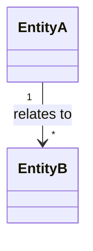

# Domain Diagram

> What exists in this problem domain, and how does it work?

## Concepts

- Entity: what it is.

## Relationships

How the concepts relate: who owns, references or produces what.

## Rules

What must always hold between them.

## Diagram

