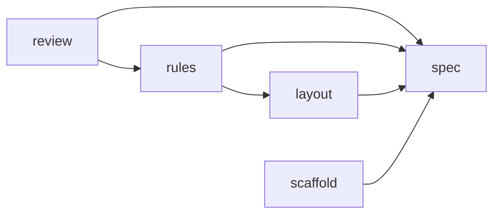
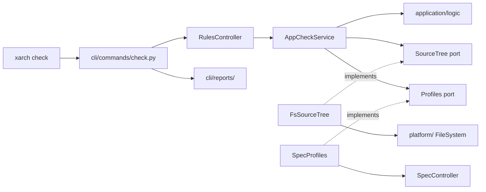

# Architecture

How xarch itself is structured: where its code lives, what each part is for, and the dependency rules that hold it together. xarch follows the architecture it checks. Its profile is `architecture.yaml` at the repository root: the bundled `cli` profile, with the packages xarch uses and the tests it has. `tests/architecture/test_self_check.py` runs `xarch check` on xarch's own source and tests against it. This page is generated from that file and from `docs/templates/architecture.md`: edit those, never this page.

## Index

- [[#1. Structure]]
- [[#2. The modules]]
- [[#3. The layers]]
- [[#4. A command through the parts]]
- [[#5. The dependency rules]]
- [[#6. How modules meet]]
- [[#7. Placement order]]
- [[#8. Inside a module]]
  - [[#8.1 contract/]]
  - [[#8.2 domain/]]
  - [[#8.3 application/controller.py]]
  - [[#8.4 application/services/]]
  - [[#8.5 application/logic/]]
  - [[#8.6 application/ports/]]
  - [[#8.7 adapters/]]
  - [[#8.8 Naming]]
- [[#9. Outside the modules]]
  - [[#9.1 profile_values/]]
  - [[#9.2 kernel/ and kernel/logic/]]
  - [[#9.3 platform/]]
  - [[#9.4 cli/ and cli/reports/]]
  - [[#9.5 bootstrap/]]

## 1. Structure

The package `xarch/` is what a profile calls the app folder. Every import of xarch's own code is absolute and starts at `xarch.`.

```
xarch/
{{tree}}

tests/                          each part's tests mirror its folder; architecture/ holds the guard tests, which check xarch's own source; fakes/ holds in-memory implementations of ports
```

> [!NOTE]
> **The tree is a closed world.** A Python file of `xarch/` outside these folders is reported by `xarch check` (`closed-tree`). The one exception is `architectures/`, which ships the bundled profiles, their templates and their example projects as data: xarch never imports or runs the example projects, so the profile lists `architectures/examples` under `excluded`. `bootstrap/migrations/` comes with the `cli` layout and holds nothing here: xarch keeps no database.

> [!NOTE]
> **The examples on this page** are short versions of real files, kept in `docs/examples/`, outside the package. They import from `app.`, as the examples of every profile do: read `app.` as `xarch.`. They leave out most of what the real files hold, and shorten a name here and there: their `Profile` port and `SpecProfile` adapter are `Profiles` and `SpecProfiles` in the code, and their `part_of` is `place_of`. `xarch review calibrate` reads the same files to hold the placement question to xarch's own parts.

## 2. The modules

Five modules hold the business code, each in `modules/<module>/`:

| Module | What it does |
|---|---|
| `spec` | reads a profile file and the data file of the language it names, checks it, explains its keys, copies a bundled one, and fills the docs templates |
| `layout` | checks that the skeleton a profile demands exists below a folder |
| `rules` | checks an app's imports, tests and structure against a profile, says what a path is (`where`), and reads the source of the checked language |
| `scaffold` | writes what `init` and `new` create, never overwriting a file |
| `review` | asks a decision model where chosen files belong, by the litmus tests of the parts: advisory, never a check |

No module imports another. A module that needs another's answer declares a port, and an adapter of its own wraps the other module's controller (section 6). Each arrow reads "wraps the controller of":



`spec` wraps no other module: every other module learns the profile from it.

## 3. The layers

Inside a module the parts sit in layers, and every import points from an outer layer to an inner one. From the inside out, the application side runs {{layers:application}}, and the edge side runs {{layers:edge}}. A service may import its logic, its ports, the contract and the domain because each is inward of it, and a controller may import its services for the same reason. `application/logic/` imports only the domain, so the services call it and it calls neither. An adapter may use `platform/`, which is inward of it and shared by every module. `profile_values/`, `kernel/logic/` and `kernel/` are inward of all of them. Section 5 lists what each part may import.

## 4. A command through the parts

`xarch check`, left to right. The command in `cli/` parses its arguments, builds the rules module's `CheckApp` and calls its controller. The controller hands the command to a service and turns each error the service raises into a `Result` variant. The service calls its ports and its logic, and assembles the `Result`. Behind the ports sit the adapters `bootstrap/` put there (dashed edges): `FsSourceTree` reads the source through the `FileSystem` of `platform/`, and `SpecProfiles` asks the spec module's controller for the profile. The service never names either.



The command hands the `Result` to `cli/reports/`, which words it, and prints the text with an exit code. Every other command runs the same way, through the controllers of the modules it calls. A command may call two modules' controllers, passing a field of one `Result` unchanged into the other's command: `check` first asks spec which app folder and which profile are in force.

## 5. The dependency rules

Each row lists what a part may import, and anything not listed is forbidden. Files within one part import each other freely: the rules look at imports between parts.

{{rules_table}}

> [!IMPORTANT]
> Two consequences follow from the table.
> - **A module never imports another module, with one exception.** An adapter may name the `contract/` of the module whose controller it wraps (section 6). `cli/` and `bootstrap/` are not modules, so they may import any module's controller and `contract/`.
> - **`cli/` goes through the controller.** It never imports a module's `domain/`, `services/`, `logic/`, `ports/` or `adapters/`.

## 6. How modules meet

A module that needs another's answer declares a port in its own words, and an adapter in its own `adapters/` implements that port by calling the other module's controller. That adapter is the only file of the module that names the other, and it names only the other's `contract/`. `bootstrap/` builds the adapter around the provider's controller, as the wiring below does for the rules module's profile:

{{example:bootstrap/wiring.py}}

`xarch check` reports every cycle of modules, each wrapping the next one's controller, with the imports that close it.

## 7. Placement order

When a piece of code does not obviously fit, run the litmus tests in this order. The first one it passes is where it goes.

{{placement}}

`kernel` comes last because its test is the broadest. The "if not" pointers inside each test name the usual near-miss; when they disagree with the order, the order decides. `xarch where <path>` prints a path's part and its litmus test before the file is written, and `xarch review` asks a decision model the same question of a file that exists.

---

## 8. Inside a module

The examples in this section come from the rules module and its `check` use case.

### 8.1 contract/

What the module promises everyone outside it: the commands a caller sends its controller and the `Result` that answers each. A `Result` is a union of variants, one per outcome. `__init__.py` lists the public names, and callers import from `contract`, never from its files.

{{example:modules/rules/contract/__init__.py}}

{{litmus:contract}}

### 8.2 domain/

The module's own values and errors, each value with its invariants. An error the module raises is a class of its own here, whatever base error it subclasses.

{{example:modules/rules/domain/rule.py, modules/rules/domain/errors.py}}

{{litmus:domain}}

### 8.3 application/controller.py

The module's façade. Each method hands its command to a service and turns each error the service raises into the `Result` variant that says it. No error of the module gets past it.

{{example:modules/rules/application/controller.py}}

{{litmus:controller}}

### 8.4 application/services/

One use case as steps: load through a port, check, act, and assemble what the use case hands out. A service calls ports and logic, and decides no rule itself.

{{example:modules/rules/application/services/app_check.py}}

{{litmus:services}}

### 8.5 application/logic/

Pure functions over the module's values, one file named for the rule it decides: no port, no file read, no clock. Most of xarch's checks live here, each a function from what the reader found to the violations.

{{example:modules/rules/application/logic/imports.py, modules/rules/application/logic/cycles.py}}

{{litmus:logic}}

### 8.6 application/ports/

`Protocol`s for what the module needs from outside it, in its own words and with no body: the files on disk, the source a reader parses, another module's answer.

{{example:modules/rules/application/ports/source_tree.py}}

{{litmus:ports}}

### 8.7 adapters/

Code that implements the module's ports, against a technology through a client of `platform/`, or against another module's controller (section 6).

One adapter stands apart: `FsSourceTree`, the reader. It is the only file of xarch that parses the language the checked app is written in. The profile reserves `ast` and `tokenize`, and only `adapters/` lists them in its `libraries`, so a second checked language needs a reader of its own: the checks read only what a reader hands them, and `bootstrap/` would pick the reader by the language the profile names. The spec module reads the imports and comments of a profile's example files through that same reader, which `bootstrap/` hands it.

{{example:modules/rules/adapters/fs_source_tree.py}}

{{litmus:adapters}}

### 8.8 Naming

Each kind of part has one naming pattern, so a name says what the thing is without opening its file.

{{naming}}

An adapter's name starts with the system it talks to (`Fs` for the filesystem, or the provider module, as in `Spec`) and ends with the name of the port it fills: `FsSourceTree` fills `SourceTree`, and `SpecProfiles` fills `Profiles`.

---

## 9. Outside the modules

### 9.1 profile_values/

The values a profile file writes under its keys (the tiers, the fakes, a guard's settings) and those the data file of its language lists (the file extension, the facts its reader supplies). The spec module builds them from the files and the rules module reads them in full, so they are shared rather than one module's own. Each is a record with no rule beyond its invariants.

{{example:profile_values/tiers.py, profile_values/language.py}}

{{litmus:profile-values}}

### 9.2 kernel/ and kernel/logic/

`kernel/` holds the primitives modules share that carry no business meaning: the base error, a finding at a place in a file tree. It also holds, on purpose, `RULES`, the catalogue of check ids a violation names, because spec and rules both need it and spec cannot import rules. `kernel/logic/` holds the pure functions two or more modules need, over the values of `kernel/` and `profile_values/`: where a path sits, which facts a language falls short of.

{{example:kernel/violations.py, kernel/logic/placement.py, kernel/logic/shortfall.py}}

For `kernel/`:

{{litmus:kernel}}

For `kernel/logic/`:

{{litmus:kernel-logic}}

### 9.3 platform/

The clients and readers of the technologies xarch uses, each knowing no module: the filesystem, YAML, JSON and TOML files, the data shipped in the package, the installed version, the running interpreter, and the decision model `review` asks.

{{example:platform/filesystem.py}}

{{litmus:platform}}

### 9.4 cli/ and cli/reports/

`cli/` is the only place that parses arguments or prints. Each command builds a module's command, calls its controller, and prints what `cli/reports/` makes of the `Result`, with an exit code. `cli/reports/` chooses the words, the counts and the layout of the text and the JSON, and decides nothing the `Result` does not hold.

{{example:cli/commands/check.py, cli/reports/check_report.py}}

For `cli/`:

{{litmus:cli}}

For `cli/reports/`:

{{litmus:reports}}

### 9.5 bootstrap/

`bootstrap/wiring.py` is the only file that decides which adapter fills which port (section 6 shows it). It builds the reader first, then spec, then the modules that wrap spec, handing each wrapping adapter the controller it wraps. `bootstrap/app.py` builds the typer app around the controllers, and it is what the `xarch` console script runs. `__main__.py` hands control to that same app, so `python -m xarch` runs it too. The key `review` sends with is read from the environment in `bootstrap/` alone: no other part may read the environment.

{{example:__main__.py}}

For `bootstrap/`:

{{litmus:bootstrap}}

For `__main__.py`:

{{litmus:main}}
