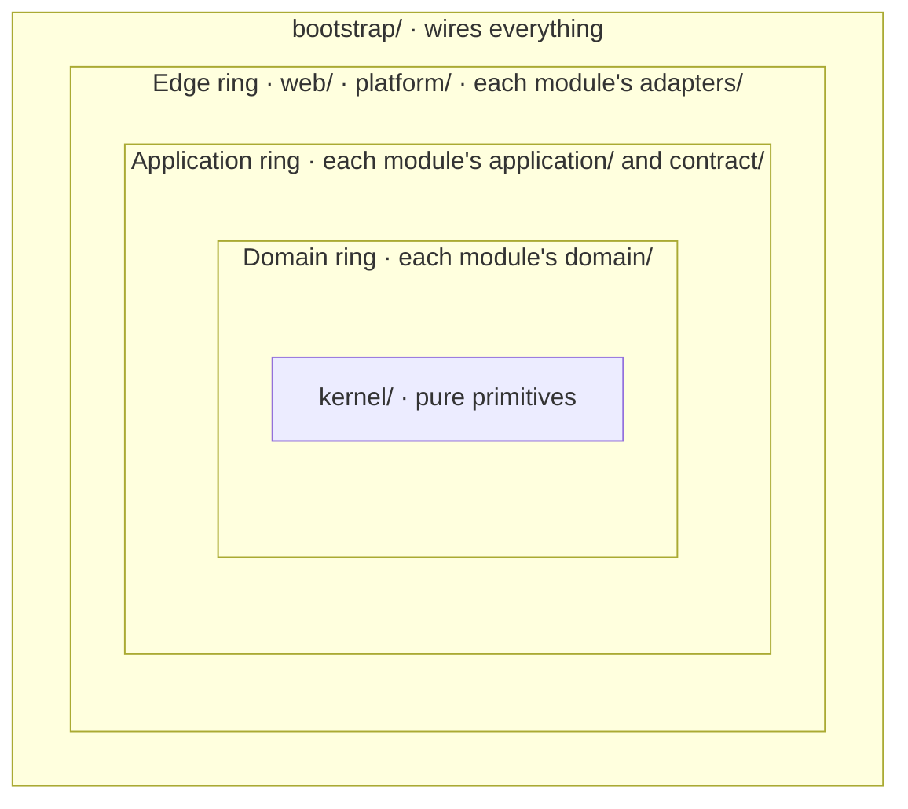
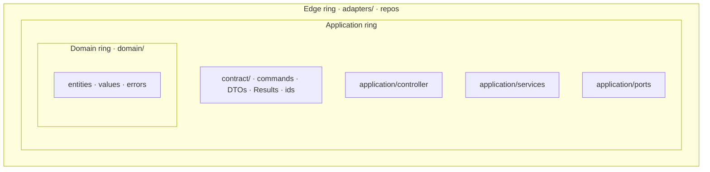
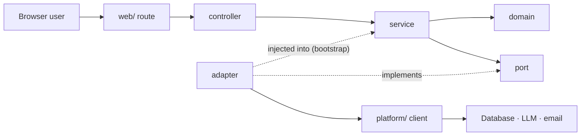
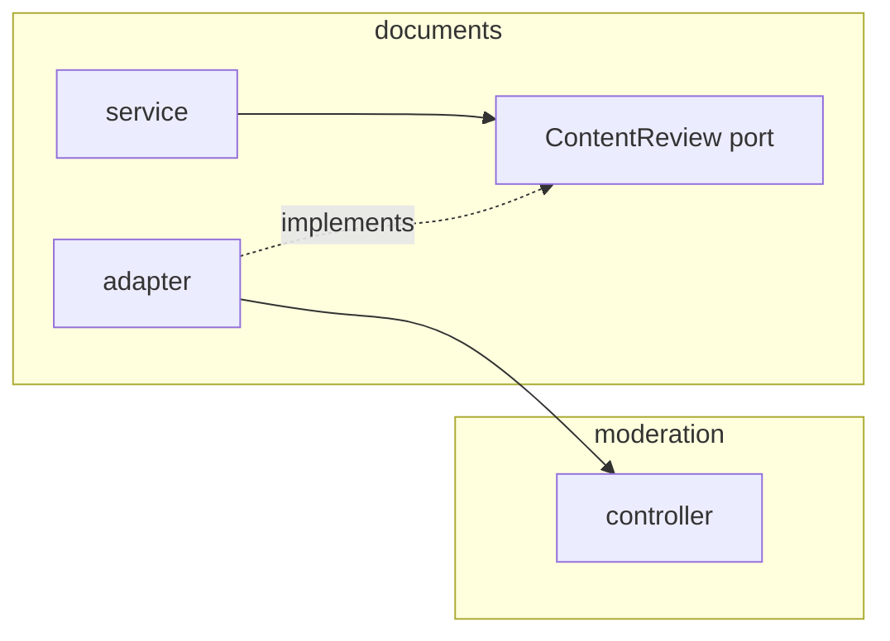

# Architecture

How the system is structured: where code lives, what each part is for, and the dependency rules that hold it together. The bounded **module** is the only unit of containment for business code, and modules reach each other only through ports. Everything else is a shared primitive, shared technology, presentation or wiring.

## Index

- [[#1. Structure]]
- [[#2. The rings across the app]]
- [[#3. The rings inside a module]]
- [[#4. A request through the rings]]
- [[#5. The dependency rules]]
- [[#6. How modules meet]]
- [[#7. Placement order]]
- [[#8. Inside a module]]
  - [[#8.1 contract/]]
  - [[#8.2 domain/]]
  - [[#8.3 application/controller.py]]
  - [[#8.4 application/services/]]
  - [[#8.5 application/ports/]]
  - [[#8.6 adapters/]]
  - [[#8.7 Naming]]
- [[#9. Outside the modules]]
  - [[#9.1 kernel/]]
  - [[#9.2 platform/]]
  - [[#9.3 web/]]
  - [[#9.4 bootstrap/]]

## 1. Structure

Every import starts at `app.`. The examples show the imports between the project's own files, because those are what the rules govern. The standard library and third-party packages are left out.

> [!NOTE]
> **Profile: web.** This copy is for a project whose entry point is a browser. The entry-point folder is `web/` (with `routes/`, `i18n/` and `ui/`). The two profiles are the only variants. The tool `xarch` carries both as data.

> [!NOTE]
> **The tree is a protocol, not a closed world.** The folders and files shown here must exist (the five top-level folders, and every module's full skeleton), and the dependency rules apply among them. Extra folders and files, such as a `scripts/` folder, a stray file at the app root or a helper beside a module's parts, are not governed by this document and are not checked. Code in an ungoverned place is outside the rules in both directions: no rule applies to it, and imports into it are not reported. The package root's `__init__.py` is likewise outside the rules, so nothing is re-exported from the root.

```
app/
├── bootstrap/                  composition root: binds ports to adapters, hands controllers to web/
│   └── migrations/             the schema and its history; the only place migrations live
├── kernel/                     pure primitives: id helpers, base errors, lifecycle fields, tracing, Clock
├── modules/
│   └── <module>/
│       ├── contract/           the module's published language: commands, DTOs, Results (one union per use case), ids
│       ├── domain/             entities, values (incl. ids), errors: invariants only
│       ├── application/
│       │   ├── controller.py   maps failures to a Result
│       │   ├── services/       use-case steps: load, check, act, persist
│       │   └── ports/          Protocols for what the module needs from the outside
│       └── adapters/           driven only: repos, which translate the platform/ table models; use platform/ clients
├── platform/                   shared technology clients: llm, embeddings, email, crypto, blob_storage, system clock, sql engine, sessions and table models
└── web/                        the only place for routes, translations and rendered output
    ├── routes/                 one file per route group; each calls module controllers
    ├── i18n/                   translated strings and locale selection
    └── ui/                     pages and components that render a Result

tests/                          each module's tests mirror its folder; architecture/ holds the dependency-rule tests; fakes/ holds in-memory implementations of ports

docs/
└── project/
    ├── statement.md                problem statement and use cases
    ├── domain.md                   domain diagram
    ├── design.md                   design document
    ├── architecture.md             this file
    ├── testing.md                  how the system is tested: tiers, commands, placement, fakes, guards
    ├── requirements.md
    ├── adrs/                       architecture decision records
    │   └── 0000-template.md
    └── artifacts/
        ├── standards/              _template.md
        ├── audits/                 _template.md
        ├── taxonomy/               _template.md
        ├── modules/                _template.md
        └── guards/                 _template.md; one per test that checks the codebase rather than the product
```

## 2. The rings across the app

Seen from the whole app, the code is arranged in rings. The rings cut across the module folders: a module's folder holds a slice of three different rings, and the ring a piece of code belongs to depends on its role, not on the folder it sits in. The next section zooms into one module.



| Ring | Where it lives | Role |
|---|---|---|
| 0, kernel | `kernel/` | Primitives with no business meaning |
| 1, domain | every module's `domain/` | Invariants |
| 2, application | every module's `application/` and `contract/` | Use cases and the caller-facing vocabulary |
| 3, edge | `web/`, `platform/`, every module's `adapters/` | Everything that touches the outside world |
| bootstrap | `bootstrap/` | Connects ring 3 to ring 2 at startup; the only part allowed to see every ring |

Each ring depends on rings inside it. Inside a module the parts are layered as well (section 3), and a part imports only from layers inward of it. The exact imports are in the dependency rules below.

> [!NOTE]
> Terms. An **adapter** is a module's driven implementation of one of its own ports, and lives in `adapters/`. An adapter can also wrap another module's controller behind one of the module's own ports (section 6). `web/` and `platform/` sit in the edge ring with the adapters, but they are not adapters: `web/` drives the modules, and `platform/` supplies technology clients that adapters use. Test fakes in `tests/fakes/` implement ports in memory and are not adapters either.

> [!NOTE]
> Inside the edge ring, `web/` depends on neither `adapters/` nor `platform/`, and `platform/` depends on no module. A module's `adapters/` may use `platform/`. The route reaches a module through its controller, and `bootstrap/` connects everything else.

## 3. The rings inside a module

Inside a module, folders and rings do not line up one to one. `domain/` is the inner ring, `application/` and `contract/` together form the application ring, and `adapters/` belongs to the edge ring even though it lives in the module's folder. This diagram shows ring membership, not folder nesting.



Within those rings, the parts of a module sit in layers, and every import points from an outer layer to an inner one. From the inside out, the application side runs `domain/` → `contract/` → `application/ports/` → `application/services/` → `application/controller.py`, and the edge side runs `platform/` → `adapters/`. A service may import its ports, the contract and the domain because each is inward of it. A controller may import its services for the same reason. An adapter may use `platform/`, which sits just inward of it and is shared by every module. `kernel/` is inward of all of them. The table in section 5 lists which of these inward parts each part may import.

## 4. A request through the rings

One request, left to right. The route translates the browser's request into a controller call. The adapter sits on the other side of the port from the service: the service calls the port, `bootstrap/` injects the adapter into the service at startup (dashed edge), and the service never names the adapter. The adapter reaches the outside world through a `platform/` client.



> [!WARNING]
> The browser is the only caller drawn, because it is the only one today. Something else, such as a database trigger, a scheduled job or an incoming event, may later call the controller exactly as a route does.

`kernel/` (pure primitives) is used by several of these parts and is left out of the diagram to keep the flow readable. Section 5 states who may import it.

## 5. The dependency rules

Dependencies point inward: a part imports only from the rings inside it (section 2) and from the layers inward of it within its module (section 3). The domain ring depends on nothing but `kernel/`. Each row below lists what a part may import, and anything not listed is forbidden. Files within one part may import each other freely (a controller its controller helpers, a `kernel/` file another `kernel/` file): the rules look at imports between parts, so what happens inside a part is not checked and is kept simple by review. The rule covers the parts in the tree in section 1, and imports into code outside it are not reported.

| Part | May import |
|---|---|
| `kernel/` | nothing |
| `domain/` | its own module's `domain/`, `kernel/` |
| `contract/` | its own module's `domain/values` (to re-export ids), `kernel/` |
| `application/` (controller, services) | its own module's `services/` (the controller only), `domain/`, `ports/` and `contract/`, `kernel/` |
| `application/ports/` | its own module's `domain/`, `kernel/` |
| `adapters/` | its own module's `application/ports/`, `domain/` and `contract/`, `kernel/`, `platform/`, and the `contract/` of a module whose controller it wraps (section 6) |
| `platform/` | `kernel/` |
| `web/` | any module's `controller` and `contract/`, `kernel/` |
| `bootstrap/` | everything; it is the only place that connects ports to adapters and passes one module's controller into another module's adapter |

> [!IMPORTANT]
> Two consequences follow from the table.
> - **A module never imports anything from another module, with one exception.** An adapter may name the `contract/` types of a module whose controller it wraps (section 6). Controllers, services, ports and domain never do. `web/` and `bootstrap/` are not modules, so they may import any module's `controller` and `contract/`.
> - **`web/` goes through the controller.** It never imports a module's `domain/`, `services/`, `ports/` or `adapters/`.

## 6. How modules meet

Modules do not import each other. They meet in two ways.

**Through the data layer.** The data layer is shared: no module owns a table exclusively. Each table is defined once, in `platform/`, as a table model with columns only. Each module gets the repos it needs, shaped by its own ports, and each repo translates the table model into the module's own vocabulary, so two modules may read the same table, each in its own words. What one module writes, another reads through its own repos. They share consequences, not code. The table models and the generic repository plumbing live once in `platform/`, and the migrations that create the tables live in `bootstrap/migrations/`.

> [!WARNING]
> Because the data layer is shared, two modules that map the same table can break each other's invariants. This is an accepted risk for now, on the judgment that it will be uncommon. If it becomes common, the options are one writing module per table with read-only access elsewhere, or a schema per module.

**Through an adapter that wraps another module's controller.** To avoid reimplementing the same business rule in two places, a module can reuse another module's rule. The consuming module declares a port in its own vocabulary, and a driven adapter implements it by calling the provider's controller. The service calls the port like any other, as `create` does in section 8.4. The adapter is the only file that names the provider, and it knows only the provider's `contract/`, the one surface it may rely on. `bootstrap/` builds the adapter around the provider's controller.



```python
# modules/documents/application/ports/content_review.py: documents' own words, no other module named
@dataclass(frozen=True)
class Allowed: ...
@dataclass(frozen=True)
class Denied: why: str
@dataclass(frozen=True)
class NoAnswer: ...

class ContentReview(Protocol):
    def review(self, title: str) -> Allowed | Denied | NoAnswer: ...

# modules/documents/adapters/moderation_content_review.py: the only file that names moderation
from app.modules.moderation.contract import ReviewText, ReviewResult, Clean, Flagged
from app.modules.documents.application.ports.content_review import Allowed, Denied, NoAnswer

class _Moderation(Protocol):                                  # the little we use of moderation's controller
    def review(self, cmd: ReviewText) -> ReviewResult: ...

class ModerationContentReview:                                # satisfies ContentReview, with no inheritance
    def __init__(self, moderation: _Moderation): self._m = moderation

    def review(self, title):
        match self._m.review(ReviewText(title)):       # moderation's contract, translated to documents' words
            case Clean():      return Allowed()
            case Flagged(why): return Denied(why)
            case _:            return NoAnswer()

# bootstrap/app.py, inside build_app (section 9.4): the adapter wraps the provider's controller
moderation = build_moderation(session)
documents = build_documents(session, clock, review=ModerationContentReview(moderation))
```

`ReviewText`, `ReviewResult`, `Clean` and `Flagged` belong to moderation's `contract/`. `Allowed`, `Denied` and `NoAnswer` are documents' own, defined beside the port. So are the errors `ContentRejected` and `ReviewUnavailable`, which live in `domain/errors.py`. The service turns `Denied` and `NoAnswer` into those errors, and the controller turns the errors into the `Rejected` and `Unavailable` variants of the create `Result`.

> [!TIP]
> **Litmus test.** Does one module need another module's rule? If yes, it declares a port in its own words, and an adapter in its own `adapters/` implements that port by calling the provider's controller. That adapter is the only place that names the provider, and it names only the provider's `contract/`.

> [!NOTE]
> The adapter translates the provider's `Result` into the consumer's outcome, and the service turns it into a domain error, so no provider type reaches the consumer's service, controller or domain. The adapter types the provider's controller with its own small `Protocol`, so it imports only `contract/`, and the type checker verifies the match where `bootstrap/` passes the real controller in.

> [!WARNING]
> `contract/` is the only real contract between modules. If the provider changes it, every adapter that wraps its controller changes with it, and that change stays inside those adapters. Dependencies between modules are not checked for cycles yet.

## 7. Placement order

When a piece of code does not obviously fit, run the litmus tests in this order. The first one it passes is where it goes. The order governs code that belongs in the tree. Code that is deliberately outside the tree (section 1) has no home to find and is not checked.

`domain` → `ports` → `services` → `controller` → `adapters` → `platform` → `web` → `bootstrap` → `contract` → `kernel`

The ports test excludes generic primitives, so `Clock` falls through to `kernel`. `kernel` comes last because "no business meaning" is the broadest test: anything that fails every earlier test and carries no business meaning is a kernel primitive.

The "if not" pointers inside each test name the usual near-miss. They are shortcuts, and when they disagree with the order above, the order decides.

> [!NOTE]
> Three tests call for judgment: `contract/` (is it a deliberate part of the module's contract), `kernel/` (does it carry business meaning), and the line between a precondition in `services/` (what the use case needs must exist or be available) and a business rule in `domain/` (what is valid to do). Decide them explicitly in review.

---

## 8. Inside a module

> [!NOTE]
> The examples in this section use a hypothetical `documents` module. They are illustrative, and the names are not final.

### 8.1 contract/

What the module promises to everyone outside it: the inputs a caller sends the controller, what comes back, and the ids that name its things. A **Result** is the union of outcomes a controller returns for one use case, and each member of the union is a variant.

```python
# modules/documents/contract/commands.py
from app.modules.documents.domain.values import DocumentId

@dataclass(frozen=True)
class PublishDocument:            # input: what a caller sends the controller
    id: DocumentId

@dataclass(frozen=True)
class CreateDocument:             # input for the create use case
    title: str

# modules/documents/contract/views.py
from app.modules.documents.domain.values import DocumentId

@dataclass(frozen=True)
class DocumentView:               # DTO: what comes back
    id: DocumentId
    title: str
    published: bool

# modules/documents/contract/results.py
from app.modules.documents.contract.views import DocumentView

# the variants of the publish Result
@dataclass(frozen=True)
class Published: view: DocumentView
@dataclass(frozen=True)
class Missing: ...
@dataclass(frozen=True)
class Rejected: reason: str          # shared with the create Result

PublishResult = Published | Missing | Rejected

# the variants of the create Result
@dataclass(frozen=True)
class Created: view: DocumentView
@dataclass(frozen=True)
class Unavailable: ...

CreateResult = Created | Rejected | Unavailable

# modules/documents/contract/__init__.py: the public names; what is not listed here is not part of the contract
from app.modules.documents.domain.values import DocumentId     # re-exported on purpose; defined in domain/values.py
from app.modules.documents.contract.commands import PublishDocument, CreateDocument
from app.modules.documents.contract.views import DocumentView
from app.modules.documents.contract.results import Published, Missing, Rejected, PublishResult, Created, Unavailable, CreateResult
```

> [!TIP]
> **Litmus test.** Is it part of what the module promises to callers outside it: an input a caller sends, an output that comes back, or an id that names the module's things? If yes, it goes here, and an id is defined in `domain/values.py` and re-exported here. If it is a `domain/` entity, a service type or a port, it stays where it is, and a DTO goes here instead.

> [!NOTE]
> A contract grows into several files, and `__init__.py` lists the public names. Other code imports from `contract`, never from its files, so the split can change without touching a caller.

> [!NOTE]
> Typed ids are re-exported from `domain/values.py` on purpose. Nothing else from `domain/`, `services/` or `ports/` is exposed through `contract/` without a deliberate decision to do so. If a caller needs a domain entity, add a DTO here, which the controller builds from the entity (section 8.3). The entity itself does not get exposed.

### 8.2 domain/

Entities and their state transitions, value objects (including typed ids) and their validation, domain errors, and pure rules that span several entities.

```python
# modules/documents/domain/values.py
DocumentId = NewType("DocumentId", UUID)

# modules/documents/domain/errors.py: each module subclasses the kernel's base errors
from app.kernel.errors import DomainError, NotFound

class DocumentNotFound(NotFound):      reason = "The document does not exist."
class AlreadyPublished(DomainError):   reason = "The document is already published."
class DocumentIncomplete(DomainError): reason = "The document needs a title."
class ContentRejected(DomainError):
    def __init__(self, why: str): self.reason = why                    # the review's reason, passed on
class ReviewUnavailable(DomainError): reason = "The content review could not answer."

# modules/documents/domain/document.py
from app.kernel.identifiers import new_id
from app.modules.documents.domain.errors import AlreadyPublished, DocumentIncomplete
from app.modules.documents.domain.values import DocumentId

class Status(Enum):
    DRAFT = "draft"
    PUBLISHED = "published"

class Document:
    def __init__(self, id: DocumentId, title: str, status: Status, published_at: datetime | None):
        self.id, self.title, self.status, self.published_at = id, title, status, published_at

    @classmethod
    def new(cls, title: str) -> "Document":
        return cls(DocumentId(new_id()), title, Status.DRAFT, None)    # new_id comes from kernel/

    def publish(self, now: datetime) -> None:
        if self.status is Status.PUBLISHED:
            raise AlreadyPublished(self.id)
        if not self.title.strip():
            raise DocumentIncomplete(self.id)
        self.status = Status.PUBLISHED
        self.published_at = now
```

> [!TIP]
> **Litmus test.** Is it a business rule, entity state transition or value validation of this module that can run with no database and no clock? If yes, it goes here. If it must load or save anything, it is a service step.

### 8.3 application/controller.py

The module's use-case façade. It delegates to a service, turns exceptions into a `Result` the caller can branch on and turns the entities the service returns into DTOs. It holds no business rules.

```python
# modules/documents/application/controller.py
from app.modules.documents.contract import (
    PublishDocument, CreateDocument, PublishResult, CreateResult, DocumentView,
    Published, Missing, Rejected, Created, Unavailable,
)
from app.modules.documents.domain.document import Document, Status
from app.modules.documents.domain.errors import (
    DocumentNotFound, AlreadyPublished, DocumentIncomplete, ContentRejected, ReviewUnavailable,
)
from app.modules.documents.application.services.document_service import DocumentService

class DocumentController:
    def __init__(self, service: DocumentService):
        self._service = service

    def publish(self, cmd: PublishDocument) -> PublishResult:
        try:
            doc = self._service.publish(cmd.id)
        except DocumentNotFound:                         # exception -> Result
            return Missing()
        except (AlreadyPublished, DocumentIncomplete) as e:
            return Rejected(e.reason)
        return Published(self._view(doc))                 # entity -> DTO

    def create(self, cmd: CreateDocument) -> CreateResult:
        try:
            doc = self._service.create(cmd.title)
        except ContentRejected as e:                     # raised after another module said no, see section 6
            return Rejected(e.reason)
        except ReviewUnavailable:                        # the review could not answer
            return Unavailable()
        return Created(self._view(doc))

    def _view(self, doc: Document) -> DocumentView:      # the DTO is built here: contract/ cannot import the entity
        return DocumentView(id=doc.id, title=doc.title, published=doc.status is Status.PUBLISHED)
```

> [!TIP]
> **Litmus test.** Does it turn what a service returns or raises into a `Result` for the caller (exceptions into variants, entities into DTOs), without deciding any business rule? If yes, it goes here. If it names HTTP status codes, templates or translated text, it belongs in `web/`. If it names SQL, it belongs in `adapters/`.

> [!NOTE]
> The name overlaps with the usual meaning of "controller" (the thing that receives a request). Here the thing that receives the request is the route in `web/`. The controller never sees HTTP or the browser.

### 8.4 application/services/

The sequence for one use case: load, check the preconditions, tell the domain to act, persist, notify. Services call ports, and never implement them. A precondition is that what the use case needs exists or is available. What is valid to do with it is the domain's call.

```python
# modules/documents/application/services/document_service.py
from app.kernel.time import Clock
from app.modules.documents.domain.document import Document
from app.modules.documents.domain.errors import DocumentNotFound, ContentRejected, ReviewUnavailable
from app.modules.documents.domain.values import DocumentId
from app.modules.documents.application.ports.content_review import ContentReview, Denied, NoAnswer
from app.modules.documents.application.ports.document_repo import DocumentRepo

class DocumentService:
    def __init__(self, repo: DocumentRepo, review: ContentReview, clock: Clock):   # review: another module, see section 6
        self._repo, self._review, self._clock = repo, review, clock

    def publish(self, id: DocumentId) -> Document:
        doc = self._repo.get(id)                    # load
        if doc is None:
            raise DocumentNotFound(id)                           # precondition: it must exist
        doc.publish(self._clock.now())                           # the domain decides if it is legal
        self._repo.save(doc)                                     # persist
        return doc

    def create(self, title: str) -> Document:
        match self._review.review(title):                 # another module, through a port (section 6)
            case Denied(why):   raise ContentRejected(why)       # the controller maps this to Rejected
            case NoAnswer():    raise ReviewUnavailable()        # the controller maps this to Unavailable
        doc = Document.new(title)
        self._repo.save(doc)                                     # persist
        return doc                                               # the entity; the controller builds the DTO
```

> [!TIP]
> **Litmus test.** Does it run one use case as the sequence "load → check preconditions → act → persist → notify" by calling ports and domain objects, without building the `Result` or the DTO? If yes, it goes here. If it decides what is valid, it belongs in `domain/`. If it builds the `Result` or the DTO, it belongs in the controller. If it touches a database, it belongs in `adapters/`.

### 8.5 application/ports/

`Protocol` definitions for repositories, search, email and anything else the application needs, written in the module's own vocabulary. A need that another module fulfills is declared the same way, in the consumer's words, and an adapter wraps the provider (section 6).

```python
# modules/documents/application/ports/document_repo.py
from app.modules.documents.domain.document import Document
from app.modules.documents.domain.values import DocumentId

class DocumentRepo(Protocol):
    def get(self, id: DocumentId) -> Document | None: ...
    def save(self, doc: Document) -> None: ...

# modules/documents/application/ports/content_review.py: ContentReview and its outcomes Allowed, Denied and NoAnswer;
#   filled by an adapter that wraps moderation, see section 6
```

> [!TIP]
> **Litmus test.** Is it something the application needs from outside itself (storage, search, email, or another module's rule) that can be declared as a `Protocol` with no implementation, in the module's own vocabulary and not in SQL or vendor terms? If yes, it goes here. If it is a generic primitive with no business meaning (such as `Clock`), it belongs in `kernel/`. If it has a body that talks to a real system, it belongs in `adapters/`.

### 8.6 adapters/

Code that implements this module's ports against a real system, using `platform/` clients for the technology: repositories, which translate between the module's types and the table models defined in `platform/`. The schema itself is created by `bootstrap/migrations/` (section 9.4 shows one), and no module owns a table exclusively. An adapter can also wrap another module's controller behind a port (section 6).

```python
# modules/documents/adapters/db_document_repo.py
from app.modules.documents.domain.document import Document, Status
from app.modules.documents.domain.values import DocumentId
from app.platform.sql import Session       # the engine and sessions are platform clients
from app.platform.sql.tables.documents import DocumentRow   # the table model, defined once in platform/

class DbDocumentRepo:                      # satisfies DocumentRepo
    def __init__(self, session: Session): self._s = session

    def get(self, id):
        row = self._s.get(DocumentRow, id)
        return self._to_domain(row) if row else None

    def save(self, doc):
        self._s.merge(self._from_domain(doc))

    def _to_domain(self, row: DocumentRow) -> Document:   # table row in, domain entity out
        return Document(DocumentId(row.id), row.title, Status(row.status), row.published_at)

    def _from_domain(self, doc: Document) -> DocumentRow: # domain entity in, table row out
        return DocumentRow(id=doc.id, title=doc.title, status=doc.status.value, published_at=doc.published_at)
```

The translation between the database's rows and the domain's entities lives here, in the adapter class, and never in `domain/` or in the table model: the domain never sees a row, and the service never sees one either.

> [!TIP]
> **Litmus test.** Does it implement one of this module's ports against a real system, translating between the module's types and that system's, and naming no other module except the `contract/` of one whose controller it wraps? If yes, it goes here. If it knows no module's types and is only a client or engine for a technology, it belongs in `platform/`. If it contains a business rule, it belongs in `domain/`.

> [!NOTE]
> Adapters are driven only. Whatever drives the module (today, a web route) calls the controller directly. The route is the translation from the caller's world to a controller call, so it lives in `web/`.

### 8.7 Naming

Each kind of part has one naming pattern, so a name says what the thing is without opening its file.

| Kind | Where | Pattern | Example |
|---|---|---|---|
| command | `contract/` | verb and thing | `PublishDocument` |
| DTO | `contract/` | thing and `View` | `DocumentView` |
| Result variant | `contract/` | the outcome, in one word | `Published`, `Missing`, `Rejected` |
| Result union | `contract/` | verb and `Result` | `PublishResult` |
| entity | `domain/` | the thing | `Document` |
| id | `domain/` | thing and `Id` | `DocumentId` |
| domain error | `domain/` | what went wrong | `DocumentNotFound`, `AlreadyPublished` |
| service | `application/services/` | thing and `Service` | `DocumentService` |
| controller | `application/` | thing and `Controller` | `DocumentController` |
| port | `application/ports/` | what the application needs, in its own words | `DocumentRepo`, `ContentReview` |
| adapter | `adapters/` | `<System><PortName>` | `DbDocumentRepo`, `ModerationContentReview` |
| table model | `platform/sql/tables/` | thing and `Row` | `DocumentRow` |
| test fake | `tests/fakes/` | `Fake` and the port's name | `FakeDocumentRepo` |

An adapter's name starts with the system it talks to (a technology such as `Db` or `Smtp`, or the provider module, as in `Moderation`) and always ends with the name of the port it fills. `DbDocumentRepo` fills `DocumentRepo`, and `ModerationContentReview` fills `ContentReview`. The `adapters/` folder says it is an adapter, and the end of the name says which port it fills.

---

## 9. Outside the modules

### 9.1 kernel/

Typed-id helpers, the base error hierarchy, lifecycle fields (created, updated, deleted), tracing carriers and the `Clock` protocol. Nothing here has business meaning.

```python
# kernel/identifiers.py
def new_id() -> UUID: return uuid4()

# kernel/errors.py
class DomainError(Exception):
    reason: str                    # a message safe to show the caller
class NotFound(DomainError): ...

# kernel/time.py
class Clock(Protocol):
    def now(self) -> datetime: ...
```

> [!TIP]
> **Litmus test.** Is it a primitive with no business meaning, one that could be lifted unchanged into an unrelated system (id helpers, base errors, lifecycle fields, tracing carriers, `Clock`)? If yes, it goes here. If it names one module's thing, such as a concrete id like `DocumentId`, or carries domain meaning (chunks, search), it belongs in the owning module. If it wraps a technology, it belongs in `platform/`.

### 9.2 platform/

Clients and engines for technology used by several modules and owned by none: the LLM client, embeddings, email, crypto, blob storage, the SQL engine, sessions and table models, and the system clock. Module adapters use most of them, while `bootstrap/` passes `SystemClock` straight to services as the kernel's `Clock`. Platform implements no module's port and imports no module.

```python
# platform/email/smtp_client.py
class SmtpClient:
    def __init__(self, host: str, port: int): ...
    def send(self, to: str, subject: str, body: str) -> None: ...

# platform/clock.py
class SystemClock:                 # satisfies kernel's Clock
    def now(self) -> datetime: return datetime.now(UTC)

# platform/sql/tables/documents.py: columns only, no module's types
class DocumentRow(SQLModel, table=True):   # the table model: the database's shape, defined once
    __tablename__ = "documents"
    id: UUID = Field(primary_key=True)
    title: str
    status: str
    published_at: datetime | None = None
```

The email client speaks plain strings and knows no module. A module adapter that implements a notification port wraps it and translates the module's types into those strings. A table model is the same kind of thing: it names a table and its columns and knows no module's types, so every module's repo can use it and translate it into its own entities (section 8.6).

> [!TIP]
> **Litmus test.** Is it a client or engine for an external technology (LLM, embeddings, email, crypto, blob storage, clock, SQL engine, table models) that knows none of the types of any one module? If yes, it goes here, named for the technology (a table model, for its table) and never for a module. If it translates a module's types for a port, it belongs in that module's `adapters/`.

### 9.3 web/

The only place that speaks HTTP or renders for the browser, whichever module's data it shows. Each route parses the request, builds the module's command object, calls the controller and renders the `Result` as a status code and a page or payload. Strings shown to the user live in `i18n/`, and rendering lives in `ui/`. Neither holds a business rule.

```python
# web/dependencies.py: how a route reaches its controller
from app.modules.documents.application.controller import DocumentController

def documents_controller(request: Request) -> DocumentController:
    return request.app.state.documents       # bootstrap/ sets it when it builds the app

# web/routes/documents.py
from app.modules.documents.application.controller import DocumentController
from app.modules.documents.contract import PublishDocument, DocumentId, Published, Missing, Rejected
from app.web.dependencies import documents_controller
from app.web.i18n import t
from app.web.ui import render

router = APIRouter()                         # bootstrap/ includes this router in the program's FastAPI

@router.post("/documents/{id}/publish")
def publish(id: UUID, documents: DocumentController = Depends(documents_controller)):
    result = documents.publish(PublishDocument(DocumentId(id)))                 # controller call
    match result:                                # the route branches on the Result
        case Published(view): return render("documents/published", view=view)
        case Missing():       raise HTTPException(404, t("documents.missing"))
        case Rejected(why):   raise HTTPException(422, why)
```

> [!TIP]
> **Litmus test.** Does it parse a request, pick a status code, translate text or render output, whichever module's data it shows? If yes, it goes here. If it reports a failure as a `Result`, it belongs in the controller. If it holds a business rule, it belongs in `domain/`.

> [!NOTE]
> A change that touches one module's behavior and its output spans two folders: `modules/<module>/` and `web/`. That is the accepted cost of not splitting rendered output across modules.

> [!NOTE]
> `bootstrap/` creates the program's `FastAPI`, includes each router in it and stores the controllers on its state. `web/dependencies.py` reads them from there, so `web/` never imports `bootstrap/`, and a route gets its controller through `Depends` and never looks it up itself.

### 9.4 bootstrap/

Builds each module's adapters, hands them to its services, and hands the services to its controller. It then hands the controllers to `web/`. It wraps a provider module's controller in the consumer's adapter (section 6), and it holds the migrations, which define the schema for every module. The only place that decides which adapter fills which port. It is also where the program's entry point lives: only `bootstrap/` may see both the entry-point folder and the adapters, so the script that starts the program is wired here and not in `web/`.

```python
# bootstrap/wiring.py
from app.kernel.time import Clock
from app.platform.sql import Session
from app.modules.documents.adapters.db_document_repo import DbDocumentRepo
from app.modules.documents.application.controller import DocumentController
from app.modules.documents.application.ports.content_review import ContentReview
from app.modules.documents.application.services.document_service import DocumentService
# ... and the same three imports for moderation: DbFlagRepo, ModerationService, ModerationController

def build_documents(session: Session, clock: Clock, review: ContentReview) -> DocumentController:
    repo = DbDocumentRepo(session)                             # the adapter fills the port
    service = DocumentService(repo, review, clock)             # injected into the service
    return DocumentController(service)

def build_moderation(session: Session) -> ModerationController:
    repo = DbFlagRepo(session)                                 # the same shape for every module
    service = ModerationService(repo)
    return ModerationController(service)

# bootstrap/app.py
from app.modules.documents.adapters.moderation_content_review import ModerationContentReview
from app.modules.documents.application.controller import DocumentController
from app.modules.moderation.application.controller import ModerationController
from app.platform.clock import SystemClock
from app.platform.sql import Session, create_engine
from app.web.routes import documents as documents_routes, moderation as moderation_routes
from app.bootstrap.settings import Settings    # bootstrap/settings.py: reads the environment
from app.bootstrap.wiring import build_documents, build_moderation

@dataclass
class App:                              # what main and the bootstrap test hold on to
    web: FastAPI
    documents: DocumentController
    moderation: ModerationController

def build_app(settings: Settings) -> App:
    engine = create_engine(settings.database_url)    # from platform/sql
    session = Session(engine)                        # session lifetime simplified here
    clock = SystemClock()                            # from platform/, used as the kernel's Clock
    moderation = build_moderation(session)
    documents = build_documents(session, clock, review=ModerationContentReview(moderation))   # an adapter wraps the provider's controller
    web = FastAPI()                                  # the program's own app object
    web.include_router(documents_routes.router)
    web.include_router(moderation_routes.router)
    web.state.documents = documents                  # what web/dependencies.py reads
    web.state.moderation = moderation
    return App(web=web, documents=documents, moderation=moderation)

# bootstrap/main.py: the script that starts the program
from app.bootstrap.app import build_app
from app.bootstrap.settings import Settings

def main() -> None:
    uvicorn.run(build_app(Settings.from_env()).web)
```

The schema is created by the migrations, one file per change, applied in order. A migration builds its tables from the table models in `platform/`, which SQLModel turns into DDL:

```python
# bootstrap/migrations/0001_create_documents.py
from app.platform.sql.tables.documents import DocumentRow   # importing it registers its table

def upgrade(engine: Engine) -> None:
    SQLModel.metadata.create_all(engine, tables=[DocumentRow.__table__])   # SQLModel builds the table from the table model
```

> [!NOTE]
> A migration builds the table from the table model, so the table model declares the columns and the migration decides when the table is created. A later change to a column is a new migration file, never an edit of an old one. Every module that reads the table translates the same table model, so a column change reaches all of them through it.

> [!TIP]
> **Litmus test.** Does it choose which adapter fills which port, build the services and controller around them, wrap one module's controller in another's adapter, or define the schema? If yes, it goes here, and nowhere else. If it only implements one module's port against a real system, it belongs in `adapters/`.
