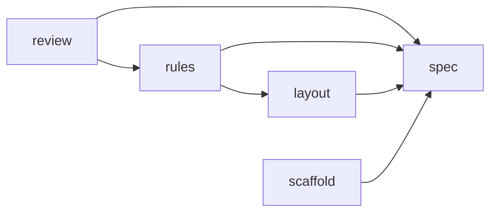
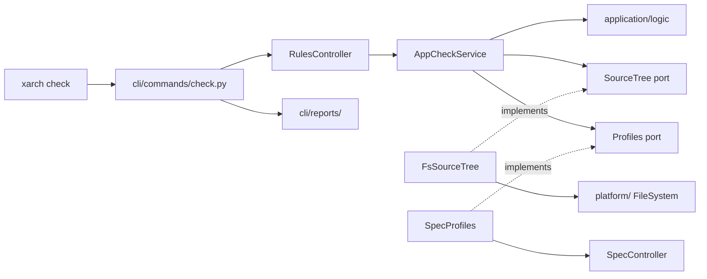

# Architecture

How xarch itself is structured: where its code lives, what each part is for, and the dependency rules that hold it together. xarch follows the architecture it checks. Its profile is `architecture.yaml` at the repository root: the bundled `cli` profile, with the packages xarch uses and the tests it has. `tests/architecture/test_self_check.py` runs `xarch check` on xarch's own source and tests against it. This page is generated from that file and from `docs/templates/architecture.md`: edit those, never this page.

## Index

- [[#1. Structure]]
- [[#2. The modules]]
- [[#3. The layers]]
- [[#4. A command through the parts]]
- [[#5. The dependency rules]]
- [[#6. How modules meet]]
- [[#7. Placement order]]
- [[#8. Inside a module]]
  - [[#8.1 contract/]]
  - [[#8.2 domain/]]
  - [[#8.3 application/controller.py]]
  - [[#8.4 application/services/]]
  - [[#8.5 application/logic/]]
  - [[#8.6 application/ports/]]
  - [[#8.7 adapters/]]
  - [[#8.8 Naming]]
- [[#9. Outside the modules]]
  - [[#9.1 profile_values/]]
  - [[#9.2 kernel/ and kernel/logic/]]
  - [[#9.3 platform/]]
  - [[#9.4 cli/ and cli/reports/]]
  - [[#9.5 bootstrap/]]

## 1. Structure

The package `xarch/` is what a profile calls the app folder. Every import of xarch's own code is absolute and starts at `xarch.`.

```
xarch/
├── modules/
│   └── <module>/
│       ├── domain/             entities, values, errors: invariants only; in published.py, the values handed out as they are
│       ├── application/
│       │   ├── logic/          pure functions over the module's domain objects
│       │   ├── ports/          Protocols for what the module needs from the outside
│       │   ├── services/       use-case steps: load, check, act; they assemble what the use case hands out
│       │   └── controller.py   maps failures to Result variants
│       ├── adapters/           implement the ports on the filesystem or another module's contract
│       └── contract/           the module's published language: commands, Results
├── platform/                   the clients and readers of the technologies xarch uses, knowing no module
├── cli/                        the only place for commands and terminal output
│   ├── reports/                formatting of Results into text and JSON
│   └── commands/
├── __main__.py                 `python -m xarch`: starts the same app as the console script
├── bootstrap/                  composition root: binds ports to adapters, hands controllers to cli/
│   └── migrations/
├── profile_values/             the values a profile and the data file of the language it names say, which spec builds and rules reads in full
└── kernel/                     pure primitives that modules share, with no business meaning; and xarch's catalogue of check ids, which a violation names
    └── logic/                  pure functions that modules share, including a rule two modules need, over the values of kernel/ and profile_values/: no type of its own

tests/                          each part's tests mirror its folder; architecture/ holds the guard tests, which check xarch's own source; fakes/ holds in-memory implementations of ports
```

> [!NOTE]
> **The tree is a closed world.** A Python file of `xarch/` outside these folders is reported by `xarch check` (`closed-tree`). The one exception is `architectures/`, which ships the bundled profiles, their templates and their example projects as data: xarch never imports or runs the example projects, so the profile lists `architectures/examples` under `excluded`. `bootstrap/migrations/` comes with the `cli` layout and holds nothing here: xarch keeps no database.

> [!NOTE]
> **The examples on this page** are short versions of real files, kept in `docs/examples/`, outside the package. They import from `app.`, as the examples of every profile do: read `app.` as `xarch.`. They leave out most of what the real files hold, and shorten a name here and there: their `Profile` port and `SpecProfile` adapter are `Profiles` and `SpecProfiles` in the code, and their `part_of` is `place_of`. `xarch review calibrate` reads the same files to hold the placement question to xarch's own parts.

## 2. The modules

Five modules hold the business code, each in `modules/<module>/`:

| Module | What it does |
|---|---|
| `spec` | reads a profile file and the data file of the language it names, checks it, explains its keys, copies a bundled one, and fills the docs templates |
| `layout` | checks that the skeleton a profile demands exists below a folder |
| `rules` | checks an app's imports, tests and structure against a profile, says what a path is (`where`), and reads the source of the checked language |
| `scaffold` | writes what `init` and `new` create, never overwriting a file |
| `review` | asks a decision model where chosen files belong, by the litmus tests of the parts: advisory, never a check |

No module imports another. A module that needs another's answer declares a port, and an adapter of its own wraps the other module's controller (section 6). Each arrow reads "wraps the controller of":



`spec` wraps no other module: every other module learns the profile from it.

## 3. The layers

Inside a module the parts sit in layers, and every import points from an outer layer to an inner one. From the inside out, the application side runs `domain/` → `contract/` → `application/logic/` → `application/ports/` → `application/services/` → `application/controller.py`, and the edge side runs `platform/` → `adapters/`. A service may import its logic, its ports, the contract and the domain because each is inward of it, and a controller may import its services for the same reason. `application/logic/` imports only the domain, so the services call it and it calls neither. An adapter may use `platform/`, which is inward of it and shared by every module. `profile_values/`, `kernel/logic/` and `kernel/` are inward of all of them. Section 5 lists what each part may import.

## 4. A command through the parts

`xarch check`, left to right. The command in `cli/` parses its arguments, builds the rules module's `CheckApp` and calls its controller. The controller hands the command to a service and turns each error the service raises into a `Result` variant. The service calls its ports and its logic, and assembles the `Result`. Behind the ports sit the adapters `bootstrap/` put there (dashed edges): `FsSourceTree` reads the source through the `FileSystem` of `platform/`, and `SpecProfiles` asks the spec module's controller for the profile. The service never names either.



The command hands the `Result` to `cli/reports/`, which words it, and prints the text with an exit code. Every other command runs the same way, through the controllers of the modules it calls. A command may call two modules' controllers, passing a field of one `Result` unchanged into the other's command: `check` first asks spec which app folder and which profile are in force.

## 5. The dependency rules

Each row lists what a part may import, and anything not listed is forbidden. Files within one part import each other freely: the rules look at imports between parts.

| Part | May import |
|---|---|
| `domain/` | `kernel/`, `kernel/logic/`, `profile_values/` |
| `application/logic/` | its own module's `domain/`, `kernel/`, `kernel/logic/`, `profile_values/` |
| `application/ports/` | its own module's `domain/`, `kernel/`, `kernel/logic/`, `profile_values/` |
| `application/services/` | its own module's `application/logic/`, `domain/`, `application/ports/` and `contract/`, `kernel/`, `kernel/logic/`, `profile_values/` |
| `application/controller.py` | its own module's `application/services/`, `contract/` and `domain/errors`, `kernel/`, `kernel/logic/`, `profile_values/` |
| `adapters/` | its own module's `application/ports/` and `domain/`, `kernel/`, `kernel/logic/`, `profile_values/`, `platform/`, any module's `contract/` |
| `contract/` | its own module's `domain/values:*Id` and `domain/published`, `kernel/`, `kernel/logic/`, `profile_values/` |
| `platform/` | `kernel/`, `kernel/logic/` |
| `cli/` | `cli/reports/`, any module's `application/controller.py` and `contract/`, `kernel/`, `kernel/logic/` |
| `cli/reports/` | any module's `contract/`, `kernel/`, `kernel/logic/` |
| `__main__.py` | `bootstrap/` |
| `bootstrap/` | everything |
| `profile_values/` | `kernel/` |
| `kernel/` | nothing |
| `kernel/logic/` | `kernel/`, `profile_values/` |

> [!IMPORTANT]
> Two consequences follow from the table.
> - **A module never imports another module, with one exception.** An adapter may name the `contract/` of the module whose controller it wraps (section 6). `cli/` and `bootstrap/` are not modules, so they may import any module's controller and `contract/`.
> - **`cli/` goes through the controller.** It never imports a module's `domain/`, `services/`, `logic/`, `ports/` or `adapters/`.

## 6. How modules meet

A module that needs another's answer declares a port in its own words, and an adapter in its own `adapters/` implements that port by calling the other module's controller. That adapter is the only file of the module that names the other, and it names only the other's `contract/`. `bootstrap/` builds the adapter around the provider's controller, as the wiring below does for the rules module's profile:

```python
# bootstrap/wiring.py: the only file that names an adapter and the port it fills
from __future__ import annotations

from dataclasses import dataclass

from app.modules.rules.adapters.fs_source_tree import FsSourceTree
from app.modules.rules.adapters.spec_profile import SpecProfile
from app.modules.rules.application.controller import RulesController
from app.modules.rules.application.services.app_check import AppCheckService
from app.modules.spec.adapters.fs_architecture_files import FsArchitectureFiles
from app.modules.spec.application.controller import SpecController
from app.modules.spec.application.services.architecture import ArchitectureService
from app.platform.filesystem import FileSystem


@dataclass(frozen=True)
class Controllers:
    rules: RulesController
    spec: SpecController


def build_controllers() -> Controllers:
    fs = FileSystem()
    spec = SpecController(ArchitectureService(FsArchitectureFiles(fs)))
    rules = RulesController(AppCheckService(SpecProfile(spec), FsSourceTree(fs)))
    return Controllers(rules, spec)
```

`xarch check` reports every cycle of modules, each wrapping the next one's controller, with the imports that close it.

## 7. Placement order

When a piece of code does not obviously fit, run the litmus tests in this order. The first one it passes is where it goes.

`domain` → `logic` → `ports` → `services` → `controller` → `adapters` → `contract` → `platform` → `cli` → `reports` → `main` → `bootstrap` → `profile-values` → `kernel` → `kernel-logic`

`kernel` comes last because its test is the broadest. The "if not" pointers inside each test name the usual near-miss; when they disagree with the order, the order decides. `xarch where <path>` prints a path's part and its litmus test before the file is written, and `xarch review` asks a decision model the same question of a file that exists.

---

## 8. Inside a module

The examples in this section come from the rules module and its `check` use case.

### 8.1 contract/

What the module promises everyone outside it: the commands a caller sends its controller and the `Result` that answers each. A `Result` is a union of variants, one per outcome. `__init__.py` lists the public names, and callers import from `contract`, never from its files.

```python
# modules/rules/contract/__init__.py: the public names; a kernel value is re-exported as it is
from __future__ import annotations

from dataclasses import dataclass
from pathlib import Path

from app.kernel.violations import Place, Violation


@dataclass(frozen=True)
class CheckApp:
    root: Path
    profile: str
    strict: bool = False


@dataclass(frozen=True)
class CycleView:
    modules: tuple[str, ...]


@dataclass(frozen=True)
class AppChecked:
    violations: tuple[Violation, ...]
    cycles: tuple[CycleView, ...]
    profile: str


@dataclass(frozen=True)
class ChecksCannotRun:
    problems: tuple[str, ...]


@dataclass(frozen=True)
class CheckRefused:
    reason: str


CheckAppResult = AppChecked | ChecksCannotRun | CheckRefused

__all__ = ["AppChecked", "CheckApp", "CheckAppResult", "CheckRefused", "ChecksCannotRun", "CycleView", "Place",
           "Violation"]
```

> [!TIP]
> **Litmus test.** Is it part of what the module promises callers outside it: a command a caller sends, a Result that comes back, or an id? If yes, it goes here, typed in full, with no field of an opaque type. A value with nothing to reshape is listed in `domain/published.py`, or is a value of `profile_values/`, and is re-exported here; everything else the module hands out is a type of its own here. If it is a domain value, a service type or a port, it stays where it is, and a type of the contract goes here instead.

### 8.2 domain/

The module's own values and errors, each value with its invariants. An error the module raises is a class of its own here, whatever base error it subclasses.

```python
# modules/rules/domain/rule.py
from __future__ import annotations

from dataclasses import dataclass, field

from app.kernel.violations import Place


@dataclass(frozen=True)
class ImportRule:
    part: str
    allowed: frozenset[str] = field(default_factory=frozenset)
    everything: bool = False

    def __post_init__(self) -> None:
        if self.everything and self.allowed:
            raise ValueError(f"part {self.part!r} may import everything, so it lists no part besides")
        if self.part in self.allowed:
            raise ValueError(f"part {self.part!r} imports its own files freely and does not list itself")

    def allows(self, target: str) -> bool:
        return self.everything or target == self.part or target in self.allowed


@dataclass(frozen=True)
class ImportSeen:
    place: Place
    importer: str
    target: str

    def __post_init__(self) -> None:
        if not self.target:
            raise ValueError(f"{self.place.shown()}: an import names what it imports")

# modules/rules/domain/errors.py
from __future__ import annotations

from app.kernel.errors import DomainError


class NoProfile(DomainError):
    pass


class ProfileUnusable(DomainError):
    pass


class SourceUnreadable(DomainError):
    def __init__(self, file: str, line: int, why: str):
        super().__init__(f"{file}:{line}: {why}")
        self.file, self.line = file, line
```

> [!TIP]
> **Litmus test.** Is it an invariant of one of this module's values or records (a validation that refuses to build a wrong one), or an error the module raises (a class of its own, whatever base error it subclasses), that runs with no file read and no clock? If yes, it goes here, on that value. A value the module works out as it runs (what it saw in a source file, a rule as it applies it) is this module's own. If it is a value the module hands out as it is, with nothing to reshape, it goes in `domain/published.py`, which `contract/` re-exports. If it is a record of what a profile file writes under a key (a tier, the fakes, a guard's settings) or of what its language's data file lists, which spec builds and rules reads in full too, it belongs in `profile_values/`, with its invariants. If it is a pure rule that is not one value's invariant, it belongs in `application/logic/`. If it must read anything, it is a service step through a port.

### 8.3 application/controller.py

The module's façade. Each method hands its command to a service and turns each error the service raises into the `Result` variant that says it. No error of the module gets past it.

```python
# modules/rules/application/controller.py
from __future__ import annotations

from app.modules.rules.application.services.app_check import AppCheckService
from app.modules.rules.contract import CheckApp, CheckAppResult, CheckRefused, ChecksCannotRun
from app.modules.rules.domain.errors import NoProfile, ProfileUnusable, SourceUnreadable


class RulesController:
    def __init__(self, service: AppCheckService):
        self._service = service

    def check(self, cmd: CheckApp) -> CheckAppResult:
        try:
            return self._service.check(cmd.root, cmd.profile)
        except (NoProfile, ProfileUnusable) as e:
            return CheckRefused(e.reason)
        except SourceUnreadable as e:
            return ChecksCannotRun((e.reason,))
```

> [!TIP]
> **Litmus test.** Does it turn each error a service raises into the Result variant that says it, and return what the service assembled, deciding nothing else? If yes, it goes here, and no error of the module leaves it past here. A use case that cannot fail has its method here too, handing the service the fields of its command and returning what the service assembled; a method that only passes its own parameters on adds nothing, and `pass-through` lists it. If it builds a Result from logic or domain values itself, that assembly belongs in a service. If it parses arguments or prints, it belongs in `cli/`.

### 8.4 application/services/

One use case as steps: load through a port, check, act, and assemble what the use case hands out. A service calls ports and logic, and decides no rule itself.

```python
# modules/rules/application/services/app_check.py
from __future__ import annotations

from pathlib import Path

from app.modules.rules.application.logic.cycles import cycles
from app.modules.rules.application.logic.imports import forbidden_imports, seen_imports
from app.modules.rules.application.ports.profile import Profile
from app.modules.rules.application.ports.source_tree import SourceTree
from app.modules.rules.contract import AppChecked, CycleView


class AppCheckService:
    def __init__(self, profile: Profile, tree: SourceTree):
        self._profile, self._tree = profile, tree

    def check(self, root: Path, location: str) -> AppChecked:
        loaded = self._profile.load(location)
        seen = [one for file in self._tree.files(root, loaded.language.extension)
                for one in seen_imports(file, self._tree.imports(root, file), loaded.patterns, root.name)]
        violations = forbidden_imports(seen, loaded.rules)
        rings = cycles(loaded.wraps)
        return AppChecked(violations, tuple(CycleView(ring) for ring in rings), loaded.name)
```

> [!TIP]
> **Litmus test.** Does it run one use case as steps (load through a port, check, act), calling ports, logic and domain values, and assemble what the use case hands out on success from what they return? If yes, it goes here. If it decides what is valid, or what the Result says (a condition, a default, a sentence), it belongs in `application/logic/`, and the service calls it. If it turns a failure into a Result variant, it belongs in the controller. If it reads a file or another module, it does so through a port.

### 8.5 application/logic/

Pure functions over the module's values, one file named for the rule it decides: no port, no file read, no clock. Most of xarch's checks live here, each a function from what the reader found to the violations.

```python
# modules/rules/application/logic/imports.py
from __future__ import annotations

from collections.abc import Iterable, Mapping

from app.kernel.logic.placement import part_of
from app.kernel.source import Import
from app.kernel.violations import Place, Violation
from app.modules.rules.domain.rule import ImportRule, ImportSeen


def seen_imports(file: str, imports: Iterable[Import], patterns: Mapping[str, tuple[str, ...]],
                 package: str) -> tuple[ImportSeen, ...]:
    importer = part_of(tuple(file.split("/")), patterns)
    if importer is None:
        return ()
    found = []
    for imp in imports:
        steps = tuple(imp.module.split("."))
        target = part_of(steps[1:], patterns) if steps[0] == package else None
        if target is not None and target != importer:
            found.append(ImportSeen(Place(file, imp.line), importer, target))
    return tuple(found)


def forbidden_imports(seen: Iterable[ImportSeen], rules: Mapping[str, ImportRule]) -> tuple[Violation, ...]:
    found = []
    for one in seen:
        rule = rules.get(one.importer)
        if rule is None or rule.allows(one.target):
            continue
        found.append(Violation(one.place, "rules", f"{one.importer} imports {one.target}, which it may not import",
                               f"move what {one.importer} needs from {one.target} inward, or import it from a part "
                               f"parts.{one.importer}.may_import lists"))
    return tuple(found)

# modules/rules/application/logic/cycles.py
from __future__ import annotations

from collections.abc import Mapping


def cycles(wraps: Mapping[str, frozenset[str]]) -> tuple[tuple[str, ...], ...]:
    found: list[tuple[str, ...]] = []
    for start in sorted(wraps):
        for path in _walks(start, wraps, (start,)):
            ring = _rotated(path)
            if ring not in found:
                found.append(ring)
    return tuple(found)


def _walks(at: str, wraps: Mapping[str, frozenset[str]], path: tuple[str, ...]) -> list[tuple[str, ...]]:
    closed = []
    for next_one in sorted(wraps.get(at, frozenset())):
        if next_one == path[0]:
            closed.append(path)
        elif next_one not in path:
            closed += _walks(next_one, wraps, path + (next_one,))
    return closed


def _rotated(path: tuple[str, ...]) -> tuple[str, ...]:
    first = path.index(min(path))
    return path[first:] + path[:first]
```

> [!TIP]
> **Litmus test.** Is it a pure function over this module's domain values that decides one rule, with no port and no file read? If yes, it goes here, in a file named for what it decides, and every record it returns is immutable. If it is one value's invariant, it belongs on that value in `domain/`. If another module needs the same rule, it belongs in `kernel/logic/`. If it must read or write anything, it is a service step through a port.

### 8.6 application/ports/

`Protocol`s for what the module needs from outside it, in its own words and with no body: the files on disk, the source a reader parses, another module's answer.

```python
# modules/rules/application/ports/source_tree.py
from __future__ import annotations

from pathlib import Path
from typing import Protocol

from app.kernel.source import Import


class SourceTree(Protocol):
    def files(self, root: Path, extension: str) -> list[str]:
        ...

    def imports(self, root: Path, file: str) -> tuple[Import, ...]:
        ...
```

> [!TIP]
> **Litmus test.** Is it something a use case of this module needs from outside it (files on disk, the source a reader parses, another module's answer), declared as a `Protocol` in this module's own words, with no body? If yes, it goes here. If it has a body that reads a file or calls another module, it belongs in `adapters/`. A value the port hands back belongs in `domain/`, unless it is already a value of `profile_values/` or `kernel/` that the port hands back as it is.

### 8.7 adapters/

Code that implements the module's ports, against a technology through a client of `platform/`, or against another module's controller (section 6).

One adapter stands apart: `FsSourceTree`, the reader. It is the only file of xarch that parses the language the checked app is written in. The profile reserves `ast` and `tokenize`, and only `adapters/` lists them in its `libraries`, so a second checked language needs a reader of its own: the checks read only what a reader hands them, and `bootstrap/` would pick the reader by the language the profile names. The spec module reads the imports and comments of a profile's example files through that same reader, which `bootstrap/` hands it.

```python
# modules/rules/adapters/fs_source_tree.py: the only kind of file that parses the checked language
from __future__ import annotations

import ast
from pathlib import Path

from app.kernel.source import Import
from app.modules.rules.domain.errors import SourceUnreadable
from app.platform.filesystem import FileSystem


class FsSourceTree:
    def __init__(self, fs: FileSystem):
        self._fs = fs

    def files(self, root: Path, extension: str) -> list[str]:
        return [path.relative_to(root).as_posix() for path in self._fs.files(root, extension)]

    def imports(self, root: Path, file: str) -> tuple[Import, ...]:
        try:
            tree = ast.parse(self._fs.read_text(root / file), filename=file)
        except SyntaxError as e:
            raise SourceUnreadable(file, e.lineno or 0, e.msg) from e
        found = []
        for node in ast.walk(tree):
            if isinstance(node, ast.Import):
                found += [Import(alias.name, node.lineno) for alias in node.names]
            elif isinstance(node, ast.ImportFrom) and node.module and node.level == 0:
                found.append(Import(node.module, node.lineno))
        return tuple(sorted(found, key=lambda imp: imp.line))
```

> [!TIP]
> **Litmus test.** Does it implement one of this module's ports against something outside the module (a technology, through a client or reader of `platform/`; the checked language's source; or another module's controller), translating between that and the module's own types, and naming no other module but the `contract/` of the one whose controller it wraps? If yes, it goes here. If it decides a rule of the module (what a check finds, whether a fact is supplied), that rule belongs in `application/logic/`, and the adapter hands it the translated values. If it knows no module's types and only wraps a technology, it belongs in `platform/`.

### 8.8 Naming

Each kind of part has one naming pattern, so a name says what the thing is without opening its file.

| Kind | Where | Pattern | Example |
|---|---|---|---|
| command | `contract/` | verb and thing | `CheckApp`, `CheckStructure`, `Locate` |
| DTO | `contract/` | thing and `View` | `FindingView`, `EnforcementView` |
| Result variant | `contract/` | the outcome, in a word or two | `AppChecked`, `NotADirectory`, `CheckRefused` |
| Result union | `contract/` | the command or use case, and `Result` | `CheckAppResult`, `ProfileCheckResult` |
| domain error | `domain/` | what went wrong | `ProfileUnusable`, `NoKey` |
| service | `application/services/` | the use case and `Service` | `AppCheckService`, `StructureCheckService` |
| pure rule | `application/logic/`, `kernel/logic/` | a file named for the rule, a function for what it answers | `cycles.py`, `place_of` |
| controller | `application/` | the module and `Controller` | `RulesController`, `SpecController` |
| port | `application/ports/` | what the module needs, in its own words | `SourceTree`, `Disk`, `DecisionModel` |
| adapter | `adapters/` | `<System><PortName>` | `FsSourceTree`, `SpecProfiles`, `FsDisk` |
| platform client | `platform/` | the technology | `FileSystem`, `YamlWriter`, `TomlReader` |
| test fake | `tests/fakes/` | `Fake` and the port's name | `FakeSourceTree`, `FakeDisk` |

An adapter's name starts with the system it talks to (`Fs` for the filesystem, or the provider module, as in `Spec`) and ends with the name of the port it fills: `FsSourceTree` fills `SourceTree`, and `SpecProfiles` fills `Profiles`.

---

## 9. Outside the modules

### 9.1 profile_values/

The values a profile file writes under its keys (the tiers, the fakes, a guard's settings) and those the data file of its language lists (the file extension, the facts its reader supplies). The spec module builds them from the files and the rules module reads them in full, so they are shared rather than one module's own. Each is a record with no rule beyond its invariants.

```python
# profile_values/tiers.py
from __future__ import annotations

from dataclasses import dataclass


@dataclass(frozen=True)
class Tier:
    name: str
    proves: str
    litmus: str
    must_import: tuple[str, ...] = ()
    types_only: tuple[str, ...] = ()
    apply_forbidden: bool = False
    folder: str = ""

    def __post_init__(self) -> None:
        if not self.proves.strip():
            raise ValueError(f"tier {self.name!r} says nothing it proves")
        if self.folder and "/" in self.folder:
            raise ValueError(f"tier {self.name!r}: its folder is one name below the tests, not {self.folder!r}")


@dataclass(frozen=True)
class Tiers:
    tiers: tuple[Tier, ...]

    def named(self, name: str) -> Tier | None:
        return next((tier for tier in self.tiers if tier.name == name), None)

# profile_values/language.py
from __future__ import annotations

from dataclasses import dataclass, field


@dataclass(frozen=True)
class Language:
    name: str
    extension: str
    facts: frozenset[str] = field(default_factory=frozenset)
    approximate: frozenset[str] = field(default_factory=frozenset)
    standard_names: frozenset[str] = field(default_factory=frozenset)

    def __post_init__(self) -> None:
        if not self.extension.startswith("."):
            raise ValueError(f"language {self.name!r}: an extension starts with '.', not {self.extension!r}")
        if not self.approximate <= self.facts:
            raise ValueError(f"language {self.name!r}: a fact supplied approximately is a fact it supplies")

    def reads(self, file: str) -> bool:
        return file.endswith(self.extension)
```

> [!TIP]
> **Litmus test.** Is it a record of what a profile file writes under one of its keys (the tiers, the fakes, a guard's settings), or of what the data file of the language it names lists (its file extension, the facts it supplies), which spec builds and rules reads in full, field by field? If yes, it goes here, as a record with no rule beyond its own invariants. A value no profile writes, worked out from an app's source (an import seen, an edge between two parts), is not one: it belongs in the `domain/` of the module that works it out. What a rule of `kernel/logic/` grades of such values (a key's shortfall of the facts a language supplies), which spec and rules both read in full, goes here too. If it is what a use case of one module found, it is that module's Result, in its `contract/`. If rules reads less than all of it, spec hands it out in its contract and rules holds a smaller value of its own. If only one module needs it, it belongs in that module's `domain/`. If it has no business meaning, one that could be lifted unchanged into an unrelated system, it belongs in `kernel/`.

### 9.2 kernel/ and kernel/logic/

`kernel/` holds the primitives modules share that carry no business meaning: the base error, a finding at a place in a file tree. It also holds, on purpose, `RULES`, the catalogue of check ids a violation names, because spec and rules both need it and spec cannot import rules. `kernel/logic/` holds the pure functions two or more modules need, over the values of `kernel/` and `profile_values/`: where a path sits, which facts a language falls short of.

```python
# kernel/violations.py
from __future__ import annotations

from dataclasses import dataclass


@dataclass(frozen=True)
class Place:
    file: str
    line: int = 0

    def __post_init__(self) -> None:
        if self.line < 0:
            raise ValueError(f"{self.file}: a line is 1 or more, or 0 for the whole file")

    def shown(self) -> str:
        return f"{self.file}:{self.line}" if self.line else self.file


@dataclass(frozen=True)
class Violation:
    place: Place
    rule: str
    message: str
    fix: str

    def __post_init__(self) -> None:
        if not self.fix.strip():
            raise ValueError(f"a violation of {self.rule!r} at {self.place.shown()} says nothing to do about it")

# kernel/logic/placement.py
from __future__ import annotations

from collections.abc import Mapping

EACH = "<module>"


def matches(path: tuple[str, ...], pattern: tuple[str, ...]) -> bool:
    if len(path) < len(pattern):
        return False
    return all(step == EACH or step == found for step, found in zip(pattern, path))


def part_of(path: tuple[str, ...], patterns: Mapping[str, tuple[str, ...]]) -> str | None:
    found = [(len(pattern), part) for part, pattern in patterns.items() if matches(path, pattern)]
    return max(found)[1] if found else None


def instance_of(path: tuple[str, ...], pattern: tuple[str, ...]) -> str | None:
    if EACH not in pattern or not matches(path, pattern):
        return None
    return path[pattern.index(EACH)]

# kernel/logic/shortfall.py: a pure rule over a value of profile_values/ that two modules need
from __future__ import annotations

from collections.abc import Iterable

from app.profile_values.language import Language


def shortfall(needed: Iterable[str], language: Language) -> frozenset[str]:
    return frozenset(needed) - language.facts


def approximated(needed: Iterable[str], language: Language) -> frozenset[str]:
    return frozenset(needed) & language.approximate


def unsupplied_keys(keys: dict[str, frozenset[str]], language: Language) -> tuple[str, ...]:
    return tuple(sorted(key for key, facts in keys.items() if shortfall(facts, language)))
```

For `kernel/`:

> [!TIP]
> **Litmus test.** Is it a primitive with no business meaning, one that could be lifted unchanged into an unrelated system, such as the base error or a finding at a place in a file tree? If yes, it goes here. An error one module raises, which subclasses the base error, is that module's own, in its `domain/`. A function that works a result out of its arguments is not a primitive, however general it reads: it goes in `kernel/logic/`, or in the one module that needs it. One exception, named on purpose: `RULES` and `OWN_ID`, xarch's catalogue of check ids and how a profile writes its own, stay here beside the `Violation` that validates them, because spec and rules both need them and spec cannot import rules. If it is a value of the profile or of the language a check reads, it belongs in `profile_values/`. If it is a pure function two modules need, it goes in `kernel/logic/`. If one module needs it, it belongs in that module.

For `kernel/logic/`:

> [!TIP]
> **Litmus test.** Is it a pure function with no port and no I/O, over `kernel/` primitives and `profile_values/` values, deciding a rule that two or more modules need (where a path sits, what a target reaches, which facts fall short)? If yes, it goes here, in a file named for the rule, and every record it returns is immutable. If only one module needs it, it belongs in that module's `application/logic/`. If it is a value or a type rather than a function, it belongs in `kernel/`, or in `profile_values/` when it has business meaning.

### 9.3 platform/

The clients and readers of the technologies xarch uses, each knowing no module: the filesystem, YAML, JSON and TOML files, the data shipped in the package, the installed version, the running interpreter, and the decision model `review` asks.

```python
# platform/filesystem.py: refuses a relative path; the caller says which folder it is read from
from __future__ import annotations

from pathlib import Path


class FileSystem:
    def read_text(self, path: Path) -> str:
        self._whole(path)
        return path.read_text(encoding="utf-8")

    def is_file(self, path: Path) -> bool:
        self._whole(path)
        return path.is_file()

    def files(self, root: Path, suffix: str) -> list[Path]:
        self._whole(root)
        return sorted(path for path in root.rglob(f"*{suffix}") if path.is_file())

    def subdirectories(self, root: Path) -> list[str]:
        self._whole(root)
        return sorted(child.name for child in root.iterdir() if child.is_dir()) if root.is_dir() else []

    @staticmethod
    def _whole(path: Path) -> None:
        if not path.is_absolute():
            raise ValueError(f"{path}: give the path in full; which folder it is read from is the caller's to say")
```

> [!TIP]
> **Litmus test.** Is it a client or reader of one technology xarch uses, wherever that technology lives (on the machine, in the interpreter running xarch, or as a service across the network), that knows none of any module's types? If yes, it goes here, named for the technology. If it translates a module's types for a port, it belongs in that module's `adapters/`. Which folder a relative path is read from is its caller's to say: a method that makes a path whole or walks the folders above it refuses a path not given in full.

### 9.4 cli/ and cli/reports/

`cli/` is the only place that parses arguments or prints. Each command builds a module's command, calls its controller, and prints what `cli/reports/` makes of the `Result`, with an exit code. `cli/reports/` chooses the words, the counts and the layout of the text and the JSON, and decides nothing the `Result` does not hold.

```python
# cli/commands/check.py
from __future__ import annotations

from pathlib import Path

import typer
from app.cli.reports.check_report import check_text
from app.modules.rules.application.controller import RulesController
from app.modules.rules.contract import AppChecked, CheckApp


def register(app: typer.Typer, rules: RulesController) -> None:
    @app.command()
    def check(root: Path = typer.Argument(..., help="the app folder, given in full"),
              profile: str = typer.Option("cli", help="a bundled profile, or the path of one"),
              strict: bool = typer.Option(False, help="fail on weak findings too")) -> None:
        result = rules.check(CheckApp(root, profile, strict))
        typer.echo(check_text(result))
        clean = isinstance(result, AppChecked) and not result.violations and not result.cycles
        raise typer.Exit(0 if clean else 1)

# cli/reports/check_report.py
from __future__ import annotations

from app.modules.rules.contract import AppChecked, CheckAppResult, CheckRefused, ChecksCannotRun


def check_text(result: CheckAppResult) -> str:
    match result:
        case AppChecked(violations=(), cycles=()):
            return f"xarch check: clean ({result.profile})"
        case AppChecked():
            return "\n".join([*_violations(result), *_cycles(result), _count(result)])
        case ChecksCannotRun(problems=problems):
            return "\n".join(["the checks cannot run:", *(f"  {problem}" for problem in problems)])
        case CheckRefused(reason=reason):
            return f"xarch check: {reason}"


def _violations(result: AppChecked) -> list[str]:
    return [f"{v.place.shown()}: {v.message} [{v.rule}]\n  fix: {v.fix}" for v in result.violations]


def _cycles(result: AppChecked) -> list[str]:
    return [f"cycle: {' -> '.join((*ring.modules, ring.modules[0]))}" for ring in result.cycles]


def _count(result: AppChecked) -> str:
    found = len(result.violations) + len(result.cycles)
    return f"{found} violation{'' if found == 1 else 's'}"
```

For `cli/`:

> [!TIP]
> **Litmus test.** Does it parse arguments, call controllers, and print what `reports/` words, whichever module's data it shows? If yes, it goes here. If it computes a value out of one module's Result for another, merges two Results into one, or decodes the conventions of a Result, that belongs in a module's service. Passing a field of one Result unchanged into another module's command, or showing two Results side by side, is the cli's. If it chooses words, it belongs in `reports/`. If it holds a business rule, it belongs in a module.

For `cli/reports/`:

> [!TIP]
> **Litmus test.** Does it only put into text or JSON what a Result already says, choosing the words, the counts and the layout, and deciding nothing the Result does not hold?

### 9.5 bootstrap/

`bootstrap/wiring.py` is the only file that decides which adapter fills which port (section 6 shows it). It builds the reader first, then spec, then the modules that wrap spec, handing each wrapping adapter the controller it wraps. `bootstrap/app.py` builds the typer app around the controllers, and it is what the `xarch` console script runs. `__main__.py` hands control to that same app, so `python -m xarch` runs it too. The key `review` sends with is read from the environment in `bootstrap/` alone: no other part may read the environment.

```python
# __main__.py
from app.bootstrap.app import app

app()
```

For `bootstrap/`:

> [!TIP]
> **Litmus test.** Does it choose which adapter fills which port, build the services and controllers around them, and hand one module's controller to the adapter of another module that wraps it? If yes, it goes here, and nowhere else. A class that implements a port, even against another module's controller, is an adapter and belongs in `adapters/`. If it decides a rule, it belongs in a module.

For `__main__.py`:

> [!TIP]
> **Litmus test.** Does it only hand control to the app bootstrap/ builds, so that `python -m xarch` runs it?
