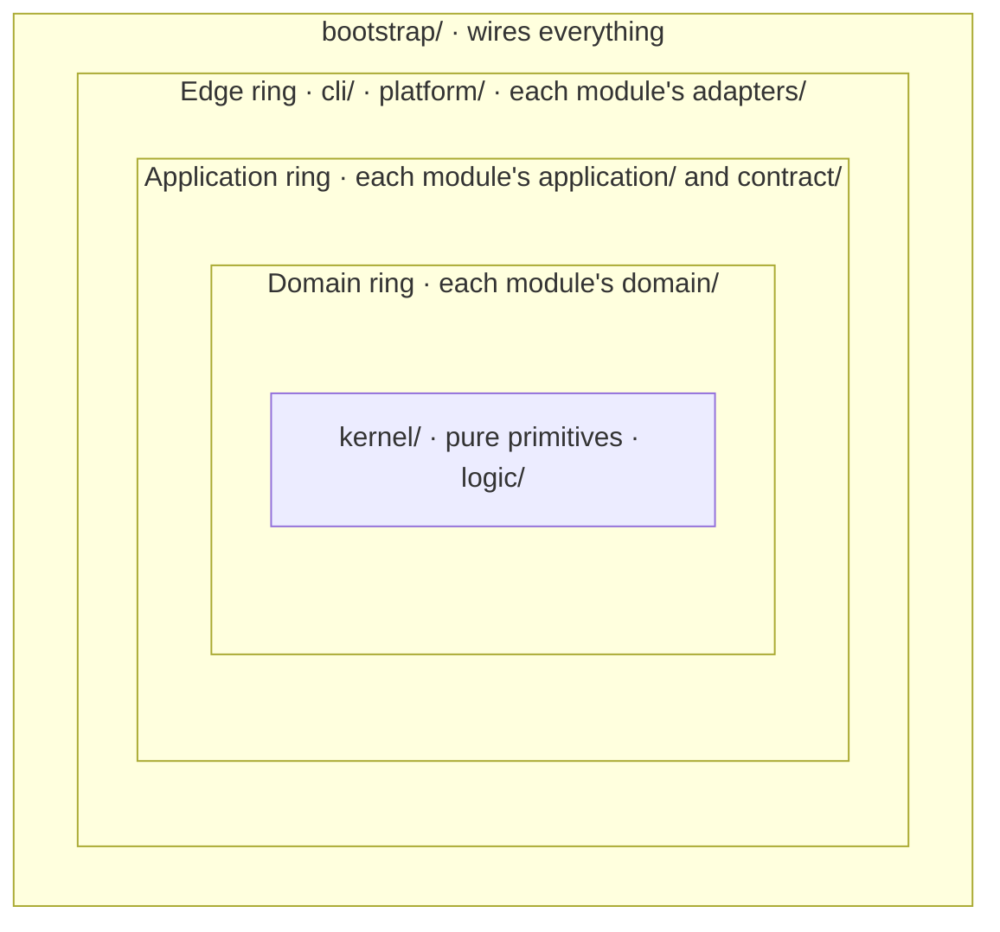
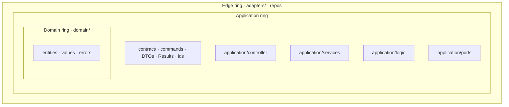
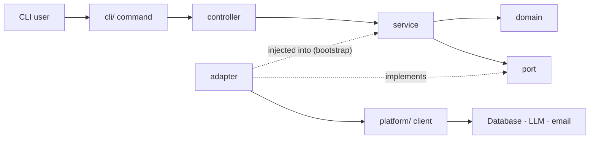
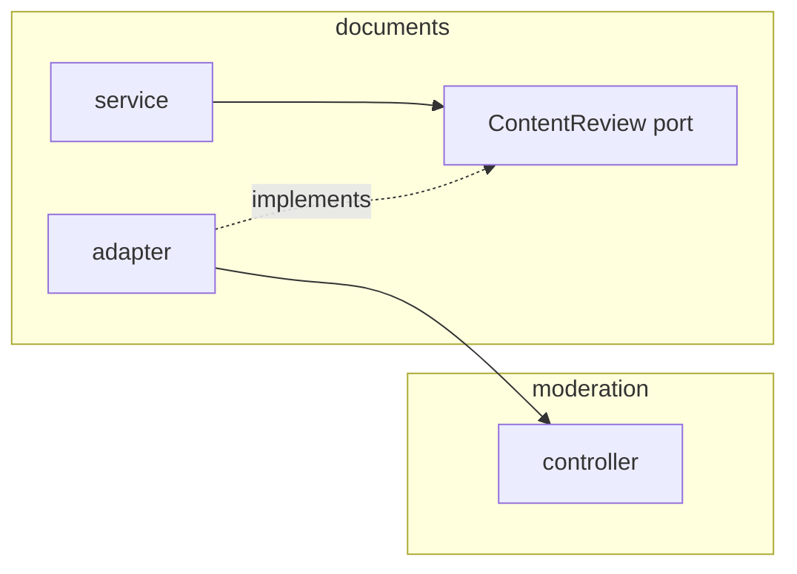

# Architecture

How the system is structured: where code lives, what each part is for, and the dependency rules that hold it together. The bounded **module** is the only unit of containment for business code, and modules reach each other only through ports. Everything else is a shared primitive, shared technology, presentation or wiring.

## Index

- [[#1. Structure]]
- [[#2. The rings across the app]]
- [[#3. The rings inside a module]]
- [[#4. A request through the rings]]
- [[#5. The dependency rules]]
- [[#6. How modules meet]]
- [[#7. Placement order]]
- [[#8. Inside a module]]
  - [[#8.1 contract/]]
  - [[#8.2 domain/]]
  - [[#8.3 application/controller.py]]
  - [[#8.4 application/services/]]
  - [[#8.5 application/logic/]]
  - [[#8.6 application/ports/]]
  - [[#8.7 adapters/]]
  - [[#8.8 Naming]]
- [[#9. Outside the modules]]
  - [[#9.1 kernel/]]
  - [[#9.2 platform/]]
  - [[#9.3 cli/]]
  - [[#9.4 bootstrap/]]
- [[#10. Callers other than the entry point]]

## 1. Structure

Every import starts at `app.`. The examples show the imports between the project's own files, because those are what the rules govern. The standard library and third-party packages are left out.

> [!NOTE]
> **Profiles and the entry point.** The tree below shows the `cli` profile, where the entry-point folder is `cli/` (with `commands/`). A project whose entry point is a browser uses the `web` profile instead: the folder is `web/` (with `routes/`, `i18n/` and `ui/`), and it follows the same row in section 5 under that name. Wherever this document says `cli/`, read "the profile's entry-point folder". The two profiles are the only variants. The tool `xarch` carries both as data.

> [!NOTE]
> **The tree is a protocol, not a closed world.** The folders and files shown here must exist (the five top-level folders, and every module's full skeleton), and the dependency rules apply among them. Extra folders and files, such as a `scripts/` folder, a stray file at the app root or a helper beside a module's parts, are not governed by this document and are not checked. Code in an ungoverned place is outside the rules in both directions: no rule applies to it, and imports into it are not reported. The package root's `__init__.py` is likewise outside the rules, so nothing is re-exported from the root.

```
app/
{{tree}}

tests/                          each module's tests mirror its folder; architecture/ holds the dependency-rule tests; fakes/ holds in-memory implementations of ports

docs/
└── project/
{{docs_tree}}
```

## 2. The rings across the app

Seen from the whole app, the code is arranged in rings. The rings cut across the module folders: a module's folder holds a slice of three different rings, and the ring a piece of code belongs to depends on its role, not on the folder it sits in. The next section zooms into one module.



| Ring | Where it lives | Role |
|---|---|---|
| 0, kernel | `kernel/` | Primitives with no business meaning, and the pure functions modules share (`kernel/logic/`) |
| 1, domain | every module's `domain/` | Invariants |
| 2, application | every module's `application/` and `contract/` | Use cases and the caller-facing vocabulary |
| 3, edge | `cli/`, `platform/`, every module's `adapters/` | Everything that touches the outside world |
| bootstrap | `bootstrap/` | Connects ring 3 to ring 2 at startup; the only part allowed to see every ring |

Each ring depends on rings inside it. Inside a module the parts are layered as well (section 3), and a part imports only from layers inward of it. The exact imports are in the dependency rules below.

> [!NOTE]
> Terms. An **adapter** is a module's driven implementation of one of its own ports, and lives in `adapters/`. An adapter can also wrap another module's controller behind one of the module's own ports (section 6). `cli/` and `platform/` sit in the edge ring with the adapters, but they are not adapters: `cli/` drives the modules, and `platform/` supplies technology clients that adapters use. Test fakes in `tests/fakes/` implement ports in memory and are not adapters either.

> [!NOTE]
> Inside the edge ring, `cli/` depends on neither `adapters/` nor `platform/`, and `platform/` depends on no module. A module's `adapters/` may use `platform/`. The command reaches a module through its controller, and `bootstrap/` connects everything else.

## 3. The rings inside a module

Inside a module, folders and rings do not line up one to one. `domain/` is the inner ring, `application/` and `contract/` together form the application ring, and `adapters/` belongs to the edge ring even though it lives in the module's folder. This diagram shows ring membership, not folder nesting.



Within those rings, the parts of a module sit in layers, and every import points from an outer layer to an inner one. From the inside out, the application side runs {{layers:application}}, and the edge side runs {{layers:edge}}. A service may import its logic, its ports, the contract and the domain because each is inward of it. A controller may import its services for the same reason. `application/logic/` imports only the domain, so the services and the controller call it and it calls neither. An adapter may use `platform/`, which sits just inward of it and is shared by every module. `kernel/` is inward of all of them. The table in section 5 lists which of these inward parts each part may import.

## 4. A request through the rings

One request, left to right. The command translates the user's invocation into a controller call. The adapter sits on the other side of the port from the service: the service calls the port, `bootstrap/` injects the adapter into the service at startup (dashed edge), and the service never names the adapter. The adapter reaches the outside world through a `platform/` client.



> [!WARNING]
> The entry point is the only caller drawn. A scheduled job or an incoming event calls the controller exactly as it does, and section 10 says where each lives.

`kernel/` (pure primitives) is used by several of these parts and is left out of the diagram to keep the flow readable. Section 5 states who may import it.

## 5. The dependency rules

Dependencies point inward: a part imports only from the rings inside it (section 2) and from the layers inward of it within its module (section 3). The domain ring depends on nothing but `kernel/`. Each row below lists what a part may import, and anything not listed is forbidden. Files within one part may import each other freely (a controller its controller helpers, a `kernel/` file another `kernel/` file): the rules look at imports between parts, so what happens inside a part is not checked and is kept simple by review. The rule covers the parts in the tree in section 1, and imports into code outside it are not reported.

{{rules_table}}

> [!IMPORTANT]
> Two consequences follow from the table.
> - **A module never imports anything from another module, with one exception.** An adapter may name the `contract/` types of a module whose controller it wraps (section 6). Controllers, services, logic, ports and domain never do. `cli/` and `bootstrap/` are not modules, so they may import any module's `controller` and `contract/`.
> - **`cli/` goes through the controller.** It never imports a module's `domain/`, `services/`, `logic/`, `ports/` or `adapters/`.

## 6. How modules meet

Modules do not import each other. They meet in two ways.

**Through the data layer.** The data layer is shared: no module owns a table exclusively. Each table is defined once, in `platform/`, as a table model with columns only. Each module gets the repos it needs, shaped by its own ports, and each repo translates the table model into the module's own vocabulary, so two modules may read the same table, each in its own words. What one module writes, another reads through its own repos. They share consequences, not code. The table models and the generic repository plumbing live once in `platform/`, and the migrations that create the tables live in `bootstrap/migrations/`.

> [!WARNING]
> Because the data layer is shared, two modules that map the same table can break each other's invariants. This is an accepted risk for now, on the judgment that it will be uncommon. If it becomes common, the options are one writing module per table with read-only access elsewhere, or a schema per module.

**Through an adapter that wraps another module's controller.** To avoid reimplementing the same business rule in two places, a module can reuse another module's rule. The consuming module declares a port in its own vocabulary, and a driven adapter implements it by calling the provider's controller. The service calls the port like any other, as `create` does in section 8.4. The adapter is the only file that names the provider, and it knows only the provider's `contract/`, the one surface it may rely on. `bootstrap/` builds the adapter around the provider's controller.



{{example:content_review, moderation_content_review}}

`ReviewText`, `ReviewResult`, `Clean` and `Flagged` belong to moderation's `contract/`. `Allowed` and `Denied` are documents' own, defined beside the port. So is the error `ContentRejected`, which lives in `domain/errors.py`. The service turns `Denied` into that error, and the controller turns the error into the `Rejected` variant of the create `Result`.

> [!TIP]
> **Litmus test.** Does one module need another module's rule? If yes, it declares a port in its own words, and an adapter in its own `adapters/` implements that port by calling the provider's controller. That adapter is the only place that names the provider, and it names only the provider's `contract/`. If the rule is a pure function with no port, it is promoted to `kernel/logic/` instead (section 9.1).

> [!NOTE]
> The adapter translates the provider's `Result` into the consumer's outcome, and the service turns it into a domain error, so no provider type reaches the consumer's service, controller or domain. The adapter types the provider's controller with its own small `Protocol`, so it imports only `contract/`, and the type checker verifies the match where `bootstrap/` passes the real controller in.

> [!WARNING]
> `contract/` is the only real contract between modules. If the provider changes it, every adapter that wraps its controller changes with it, and that change stays inside those adapters. Two modules may not depend on each other, directly or through others: `xarch check` reports every cycle of modules, each wrapping the next one's controller, with the imports that close it.

## 7. Placement order

When a piece of code does not obviously fit, run the litmus tests in this order. The first one it passes is where it goes. The order governs code that belongs in the tree. Code that is deliberately outside the tree (section 1) has no home to find and is not checked.

{{placement}}

The ports test excludes generic primitives, so `Clock` falls through to `kernel`. The logic test excludes a rule another module also needs, so it falls through to `kernel/logic/`. `kernel` comes last because its test is the broadest: anything that fails every earlier test and either carries no business meaning or is a pure function that modules share goes there.

The "if not" pointers inside each test name the usual near-miss. They are shortcuts, and when they disagree with the order above, the order decides.

> [!NOTE]
> Three tests call for judgment: `contract/` (is it a deliberate part of the module's contract), `kernel/` (does it carry no business meaning, or is it a pure function shared by modules and so promoted to `kernel/logic/`), and the line between a precondition in `services/` (what the use case needs must exist or be available) and a business rule in `domain/` (what is valid to do). Decide them explicitly in review.

---

## 8. Inside a module

> [!NOTE]
> The examples in this section use a hypothetical `documents` module. They are illustrative, and the names are not final.

### 8.1 contract/

What the module promises to everyone outside it: the inputs a caller sends the controller, what comes back, and the ids that name its things. A **Result** is the union of outcomes a controller returns for one use case, and each member of the union is a variant.

{{example:contract_commands, contract_views, contract_results, contract_init}}

{{litmus:contract}}

> [!NOTE]
> A contract grows into several files, and `__init__.py` lists the public names. Other code imports from `contract`, never from its files, so the split can change without touching a caller.

> [!NOTE]
> Typed ids are re-exported from `domain/values.py` on purpose. Nothing else from `domain/`, `services/` or `ports/` is exposed through `contract/` without a deliberate decision to do so. If a caller needs a domain entity, add a DTO here, which the controller builds from the entity (section 8.3). The entity itself does not get exposed.

### 8.2 domain/

Entities and their state transitions, value objects (including typed ids) and their validation, and domain errors: the invariants of each entity and value. A pure rule that is not one entity's invariant goes in `application/logic/` (section 8.5).

{{example:domain_values, domain_errors, document}}

{{litmus:domain}}

### 8.3 application/controller.py

The module's use-case façade. It delegates to a service, turns exceptions into a `Result` the caller can branch on and turns the entities the service returns into DTOs. It holds no business rules.

{{example:controller}}

{{litmus:controller}}

> [!NOTE]
> The name overlaps with the usual meaning of "controller" (the thing that receives a request). Here the thing that receives the request is the command in `cli/`. The controller never sees argv or the terminal.

### 8.4 application/services/

The sequence for one use case: load, check the preconditions, tell the domain to act, persist, notify. Services call ports, and never implement them. A precondition is that what the use case needs exists or is available. What is valid to do with it is the domain's call.

{{example:document_service}}

{{litmus:services}}

### 8.5 application/logic/

Pure functions over the module's domain objects, one file named for the rule it holds. A rule or step that is not one entity's invariant lives here, so a service calls it instead of holding it. It takes values and returns values: no port, no I/O, no clock.

```python
{{example:staleness}}

# in DocumentService (section 8.4), which calls the rule and does not hold it
from app.modules.documents.application.logic.staleness import is_stale

        if is_stale(doc, self._clock.now()): ...
```

{{litmus:logic}}

### 8.6 application/ports/

`Protocol` definitions for repositories, search, email and anything else the application needs, written in the module's own vocabulary. A need that another module fulfills is declared the same way, in the consumer's words, and an adapter wraps the provider (section 6).

```python
{{example:document_repo}}

# modules/documents/application/ports/content_review.py: ContentReview and its outcomes Allowed and Denied;
#   filled by an adapter that wraps moderation, see section 6
```

{{litmus:ports}}

### 8.7 adapters/

Code that implements this module's ports against a real system, using `platform/` clients for the technology: repositories, which translate between the module's types and the table models defined in `platform/`. The schema itself is created by `bootstrap/migrations/` (section 9.4 shows one), and no module owns a table exclusively. An adapter can also wrap another module's controller behind a port (section 6).

{{example:db_document_repo}}

The translation between the database's rows and the domain's entities lives here, in the adapter class, and never in `domain/` or in the table model: the domain never sees a row, and the service never sees one either.

{{litmus:adapters}}

> [!NOTE]
> Adapters are driven only. Whatever drives the module (today, a CLI command) calls the controller directly. The command is the translation from the caller's world to a controller call, so it lives in `cli/`.

### 8.8 Naming

Each kind of part has one naming pattern, so a name says what the thing is without opening its file.

{{naming}}

An adapter's name starts with the system it talks to (a technology such as `Db` or `Smtp`, or the provider module, as in `Moderation`) and always ends with the name of the port it fills. `DbDocumentRepo` fills `DocumentRepo`, and `ModerationContentReview` fills `ContentReview`. The `adapters/` folder says it is an adapter, and the end of the name says which port it fills.

---

## 9. Outside the modules

### 9.1 kernel/

Primitives with no business meaning: typed-id helpers, the base error hierarchy, lifecycle fields (created, updated, deleted), tracing carriers and the `Clock` protocol. `kernel/logic/` holds the pure functions that modules share, including a business rule two modules need: modules never import each other, so a shared rule is promoted here. Like the rest of `kernel/`, it imports nothing outside `kernel/`.

{{example:kernel_identifiers, kernel_errors, kernel_time, kernel_text}}

{{litmus:kernel}}

### 9.2 platform/

Clients and engines for technology used by several modules and owned by none: the LLM client, embeddings, email, crypto, blob storage, the SQL engine, sessions and table models, and the system clock. Module adapters use most of them, while `bootstrap/` passes `SystemClock` straight to services as the kernel's `Clock`. Platform implements no module's port and imports no module.

{{example:smtp_client, system_clock, documents_table}}

The email client speaks plain strings and knows no module. A module adapter that implements a notification port wraps it and translates the module's types into those strings. A table model is the same kind of thing: it names a table and its columns and knows no module's types, so every module's repo can use it and translate it into its own entities (section 8.7).

{{litmus:platform}}

### 9.3 cli/

The only place that parses command-line arguments or prints to the terminal, whichever module's data it shows. Each command parses its arguments, builds the module's command object, calls the controller and renders the `Result` as text and an exit code.

{{example:dependencies, documents_commands}}

{{litmus:cli}}

> [!NOTE]
> A change that touches one module's behavior and its output spans two folders: `modules/<module>/` and `cli/`. That is the accepted cost of not splitting terminal output across modules.

> [!NOTE]
> `bootstrap/` creates the program's `Typer`, adds each command group to it and passes the `App` in as the context object. `cli/dependencies.py` reads the controllers from it, so `cli/` never imports `bootstrap/`, and a command gets its controller through that function and never looks it up itself.

### 9.4 bootstrap/

Builds each module's adapters, hands them to its services, and hands the services to its controller. It then hands the controllers to `cli/`. It wraps a provider module's controller in the consumer's adapter (section 6), and it holds the migrations, which define the schema for every module. The only place that decides which adapter fills which port. It is also where the program's entry point lives: only `bootstrap/` may see both the entry-point folder and the adapters, so the script that starts the program is wired here and not in `cli/`.

{{example:wiring, bootstrap_app, bootstrap_main}}

The schema is created by the migrations, one file per change, applied in order. A migration builds its tables from the table models in `platform/`, which SQLModel turns into DDL:

{{example:migration}}

> [!NOTE]
> A migration builds the table from the table model, so the table model declares the columns and the migration decides when the table is created. A later change to a column is a new migration file, never an edit of an old one. Every module that reads the table translates the same table model, so a column change reaches all of them through it.

{{litmus:bootstrap}}

## 10. Callers other than the entry point

A scheduled job or an incoming event calls a controller exactly as a command does, and needs nothing else from the architecture:

- **A job** is an entry point wired by `bootstrap/`, in `bootstrap/jobs/<job>.py`. It builds the app as `main` does, builds the command, calls the controller and exits. The work is a function that takes the controller, so it can be handed a fake one.
- **A request from another system**, such as a webhook, is still a request to the entry point's folder, so it lives in `cli/`. `cli/` cannot import `platform/`, so a check that needs a technology client, such as verifying a signature, is a port of the module that an adapter fills from `platform/` (section 8.7). A failed check is a `Result` variant like any other.
- **A message from a queue** is handled like a job.

> [!TIP]
> **Litmus test.** Is it a caller that is not a person at the entry point? If yes, it is a job in `bootstrap/jobs/`, or a route in `cli/` when it arrives as a request, and either one only builds a command and calls a controller. If it holds a rule, it belongs in `domain/`.
